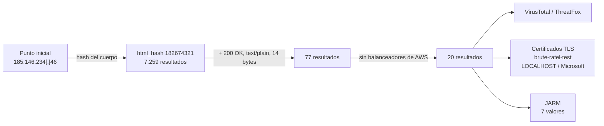

> **TLP:CLEAR** · Confianza global: **media** · Investigación: julio de 2026 · Última actualización: 2026-11-07
{: .prompt-info .notranslate translate="no" }

## Ideas clave

Partiendo del punto inicial `185.146.234[.]46`{: .notranslate translate="no"}, construí una huella con la respuesta HTTP que lo caracterizaba: un **`200 OK`** con `Content-Type: text/plain` y un cuerpo de **14 bytes**. Al identificar el contenido a partir del hash de Shodan, resulta que ese cuerpo es el texto **`Page not found`**: el servidor dice que la página no existe, pero responde como si todo fuera bien.

Esa contradicción es la huella. Combinada con el hash del cuerpo, reduce **7.259 resultados a 77**, y descartando los balanceadores de carga de AWS (que devuelven una respuesta idéntica sin relación con Brute Ratel), a **20 servidores**. Varios ya están reportados como C2 de Brute Ratel en ThreatFox y en VirusTotal, y uno presenta un certificado con el nombre **`brute-ratel-test`**.

Mi evaluación es que el clúster corresponde a servidores de **Brute Ratel C4 con confianza media**. La huella es eficaz, pero el filtro que elimina AWS es amplio: además de los balanceadores de carga, descarta cualquier servidor de Brute Ratel alojado en Amazon. Propongo una alternativa más precisa en *Hunting*.

## Contexto: qué es Brute Ratel C4

**Brute Ratel C4** (BRc4) es un framework comercial de simulación de adversarios para equipos de red team, comparable a Cobalt Strike. Lo publicó a finales de 2020 el investigador Chetan Nayak, y está diseñado específicamente para **evadir antivirus y EDR**.

Su paso al uso malicioso está bien documentado:

- **Julio de 2022:** Unit 42 (Palo Alto Networks) publicó el análisis de una muestra que usaba Brute Ratel, disfrazada de currículum en una imagen ISO. Su estructura recordaba al *tradecraft* de APT29, aunque Unit 42 lo presentó como un parecido, no como una atribución confirmada.
- **Septiembre de 2022:** una **copia crackeada** de la versión 1.2.2 empezó a circular gratis en foros de cibercrimen. Desde entonces, la herramienta puede usarse sin licencia, lo que la puso al alcance de grupos de ransomware y otros actores.

Por eso, encontrar un servidor de Brute Ratel tiene dos lecturas posibles: un **ejercicio de red team con licencia** o una **operación maliciosa con una copia pirata**. La infraestructura por sí sola no permite distinguirlas.

## Punto de partida

El punto de pivote inicial es `185.146.234[.]46`{: .notranslate translate="no"}. Su respuesta tenía estas características:

```http
HTTP/1.1 200 OK
Content-Type: text/plain; charset=utf-8
Content-Length: 14
```
{: .notranslate translate="no" }

Cuando hice la búsqueda, el 24 de julio de 2026, Shodan no tenía registros actuales del punto inicial, así que el pivote partió del **hash del cuerpo HTML** y de las cabeceras: `http.html_hash:182674321`.

### Qué hay en esos 14 bytes

Shodan calcula el hash del cuerpo de cada respuesta con MurmurHash3. Probando cadenas candidatas, la que produce exactamente `182674321` es:

```text
Page not found
```
{: .notranslate translate="no" }

Son 14 caracteres, sin salto de línea al final. Eso convierte la respuesta en algo llamativo:

| Elemento | Qué indica |
|---|---|
| `200 OK` | El servidor indica que la petición ha ido bien |
| Cuerpo `Page not found` | ...pero el texto dice que la página no existe |
| `text/plain; charset=utf-8` | Respuesta en texto plano, sin HTML |
| Sin cabecera `Server` | En los resultados finales, el servidor no se identifica |
{: .notranslate translate="no" }

Un servidor web normal devuelve `404` cuando una página no existe. Responder `200` con un mensaje de error es típico de un servidor de C2 que muestra una respuesta señuelo a quien no es un beacon legítimo.

## Metodología de pivoting

<div class="notranslate" translate="no" markdown="1">



</div>

### 1. Hash del cuerpo

La búsqueda `http.html_hash:182674321` devolvió **7.259 resultados**. La mayoría no tiene nada que ver con Brute Ratel: son servidores que devuelven el mismo texto "Page not found", pero con un **`404`**, que es lo correcto. El hash, por sí solo, no basta.

### 2. Hash + cabeceras

Añadiendo las cabeceras de la respuesta (`200 OK`, `text/plain; charset=utf-8` y `Content-Length: 14`), los resultados bajaron a **77**. Según la investigación previa del ejercicio, esta combinación es característica de los despliegues de Brute Ratel.

### 3. Descarte de Amazon

Al revisar los 77 resultados en VirusTotal, **ninguno de los alojados en Amazon tenía relación con informes de Brute Ratel**. Además, todos llevaban la cabecera **`Server: awselb/2.0`**, que identifica a los balanceadores de carga de AWS. Hasta donde sé, la añaden a las respuestas que generan ellos mismos, como las respuestas fijas configuradas para las rutas que no existen. Excluyendo las organizaciones de Amazon quedaron **20 resultados**:

```text
http.html_hash:182674321 HTTP/1.1 200 OK Content-Type: text/plain; charset=utf-8 Content-Length: 14
-org:"Amazon.com, Inc." -org:"Amazon Data Services NoVa" -org:"Amazon Technologies Inc."
```
{: .notranslate translate="no" }

{: width="1547" height="864" }
_20 servidores con la huella: Estados Unidos, Alemania y Países Bajos; sobre todo en el puerto 443_

## Hallazgos

### Distribución de la infraestructura

| Dimensión | Resultado (20 servidores) |
|---|---|
| Países | Estados Unidos (5), Alemania (4), Países Bajos (3), Austria (1), Australia (1) |
| Puertos | 443 (13), 8443 (3), 80 (1), 4433 (1), 8080 (1) |
| Proveedor principal | DigitalOcean (4) |

Predominan los **puertos HTTPS** (443, 8443, 4433). Los proveedores son VPS y nubes comerciales: DigitalOcean, Hetzner y proveedores más pequeños.

### Certificados TLS

Los certificados de los resultados aportan pistas adicionales:

| Servidor | Certificado | Lectura |
|---|---|---|
| `159.89.20[.]126` (DigitalOcean, Fráncfort) | Nombre común **`brute-ratel-test`** | Explícito. Puede ser un entorno de pruebas de un red team o de un investigador |
| `91.84.111[.]104` (Servers Tech, Ámsterdam) | Autofirmado, **`LOCALHOST`**, organización **Microsoft** | Certificado falso que suplanta a Microsoft |
| `77.88.193[.]134` (Ante Mediam, Kiev) | Organización **Internet Widgits Pty Ltd** | Valor por defecto de OpenSSL: certificado generado con prisa y sin personalizar |
{: .notranslate translate="no" }

No he podido comprobar si alguno de estos certificados es el que Brute Ratel genera por defecto.

### Corroboración externa

- **`91.84.111[.]104`{: .notranslate translate="no"}**: 9 de 91 motores lo marcan como malicioso en VirusTotal. **ThreatFox** lo registra como C2 de **`brute_ratel`** en el puerto 8443, unos tres meses antes de esta investigación, y otro usuario de la comunidad lo describe como servidor de C2 de Brute Ratel.
- **`77.88.193[.]134`{: .notranslate translate="no"}**: 0 de 91 detecciones, pero VirusTotal registra **dos ficheros detectados como maliciosos que se comunican con esta IP**, y un comentario de la comunidad lo identifica como C2 de Brute Ratel.
- **`46.4.195[.]61`{: .notranslate translate="no"}** (Hetzner): AlphaSOC lo clasifica como malware.
- **`159.89.20[.]126`{: .notranslate translate="no"}**: 0 de 91 detecciones. Su DNS pasivo incluye `fe-2.strangled[.]net` (2 de 91, en febrero de 2021), pero cinco años antes de esta observación: lo más probable es que corresponda a un inquilino anterior de la IP.

{: width="700" }
_91.84.111[.]104: reportado en ThreatFox como brute_ratel (puerto 8443)_

{: width="1000" }
_77.88.193[.]134: dos ficheros detectados se comunican con la IP; la comunidad lo identifica como C2 de Brute Ratel_

### Huellas JARM

El análisis de facetas de Shodan sobre los 20 resultados muestra **7 huellas JARM distintas**, pero muy concentradas: las dos más frecuentes cubren 12 de los 20 servidores.

{: width="1000" }
_Siete huellas JARM; las dos primeras agrupan 12 de los 20 servidores_

JARM resume cómo responde la pila TLS de un servidor, así que la comparten muchas aplicaciones sin relación entre sí. **No sirve como huella por sí sola**, pero puede ayudar a priorizar resultados cuando se combina con la huella HTTP. Con solo 20 resultados, tampoco puede concluirse mucho de su distribución.

### Cronología

| Fecha | Evento |
|---|---|
| Finales de 2020 | Publicación de Brute Ratel C4 |
| 2021-02-18 | `fe-2.strangled[.]net` resuelve a `159.89.20[.]126` (DNS pasivo, probablemente otro inquilino) |
| 2022-07 | Unit 42 documenta el uso de Brute Ratel en una campaña con parecidos a APT29 |
| 2022-09 | Circula en foros de cibercrimen una copia crackeada de Brute Ratel 1.2.2 |
| ~2026-04 | ThreatFox registra `91.84.111[.]104` como C2 de brute_ratel |
| ~2026-05 | La comunidad de VirusTotal identifica `91.84.111[.]104` y `77.88.193[.]134` como C2 de Brute Ratel |
| 2026-07-22 / 23 | Shodan observa la huella en `159.89.20[.]126`, `77.88.193[.]134` y `91.84.111[.]104` |
| 2026-07-24 | Cierre de la investigación |
{: .notranslate translate="no" }

## Indicadores

Todos los indicadores están **defangeados**. Incluyo las dos huellas JARM más frecuentes con confianza baja: sirven para priorizar resultados, no para bloquear.



📥 [Descargar IOCs en CSV]({{ '/assets/iocs/brute-ratel-c4.csv' | relative_url }})

## Mapeo MITRE ATT&CK

| Técnica | Nombre | Fuente |
|---|---|---|
| [T1588.002](https://attack.mitre.org/techniques/T1588/002/) | Obtain Capabilities: Tool | Observado (Brute Ratel C4) |
| [T1583.003](https://attack.mitre.org/techniques/T1583/003/) | Acquire Infrastructure: Virtual Private Server | Observado (DigitalOcean, Hetzner y otros) |
| [T1587.003](https://attack.mitre.org/techniques/T1587/003/) | Develop Capabilities: Digital Certificates | Observado (certificados autofirmados, uno suplantando a Microsoft) |
| [T1665](https://attack.mitre.org/techniques/T1665/) | Hide Infrastructure | Observado (respuesta señuelo "Page not found") |
| [T1071.001](https://attack.mitre.org/techniques/T1071/001/) | Application Layer Protocol: Web Protocols | Reportado (ThreatFox, VirusTotal) |

"Observado" significa visible en la infraestructura analizada; "Reportado" significa que procede de la fuente indicada y no lo he verificado yo.

## Hunting / detección

### Infraestructura (Shodan)

**Consulta de la investigación**, la que dio los 20 resultados:

```text
http.html_hash:182674321 HTTP/1.1 200 OK Content-Type: text/plain; charset=utf-8 Content-Length: 14 -org:"Amazon.com, Inc." -org:"Amazon Data Services NoVa" -org:"Amazon Technologies Inc."
```
{: .notranslate translate="no" }

**Variante sugerida, sin probar**, que descarta solo los balanceadores de AWS y no toda la nube de Amazon. Así se conservarían los servidores de Brute Ratel alojados directamente en instancias de AWS:

```text
http.html_hash:182674321 HTTP/1.1 200 OK Content-Type: text/plain; charset=utf-8 Content-Length: 14 -"awselb"
```
{: .notranslate translate="no" }

**Certificados de los resultados**, combinados con la huella HTTP:

```text
http.html_hash:182674321 ssl.cert.subject.cn:"brute-ratel-test"
http.html_hash:182674321 ssl.cert.issuer.cn:"LOCALHOST"
```
{: .notranslate translate="no" }

La sintaxis de los filtros de Shodan puede variar entre planes; comprueba estas consultas en tu cuenta antes de automatizarlas.

### Red y endpoint (para defensores)

- **Conexiones salientes** hacia las IPs de la tabla de indicadores en los logs de firewall y proxy, sobre todo hacia los puertos 443 y 8443. Busca patrones periódicos, típicos de un beacon.
- **Detección por comportamiento.** Brute Ratel genera *payloads* nuevos con facilidad y está diseñado para evadir el antivirus, así que los indicadores estáticos caducan rápido. Tras la filtración de la versión crackeada, varios análisis recomendaron priorizar la detección por comportamiento en el endpoint frente a los IOCs.
- **Si analizas un C2 sospechoso** y recibes un `200 OK` con "Page not found", no lo descartes: es exactamente la respuesta señuelo de este clúster.

### Mitigación

- **Bloquea los indicadores de confianza alta y media** en el perímetro, revisando antes que no haya tráfico legítimo hacia ellos.
- **Si tu organización contrata ejercicios de red team**, confirma con el equipo responsable si alguna de estas IPs es suya, sobre todo `159.89.20[.]126` por su certificado `brute-ratel-test`.

## Limitaciones y nivel de confianza

- **El filtro de Amazon es demasiado amplio.** La consulta final descarta todas las organizaciones de Amazon. El descarte se hizo porque ningún resultado de AWS tenía relación con Brute Ratel en VirusTotal y todos procedían de balanceadores de carga (`Server: awselb/2.0`), pero así se pierden también los servidores de Brute Ratel que un operador aloje directamente en instancias de AWS. La variante con `-"awselb"` de la sección *Hunting* debería corregirlo; no la he probado.
- **El origen de la huella procede del ejercicio.** La combinación `200 OK` + `text/plain` + 14 bytes se tomó como característica de Brute Ratel a partir de la documentación del ejercicio. No he podido confirmar si es la respuesta por defecto de Brute Ratel o una configuración concreta del operador.
- **Brute Ratel no es malware en sí.** Es una herramienta comercial de red team. Algunos de los 20 servidores pueden ser ejercicios autorizados, como sugiere el certificado `brute-ratel-test`.
- **Corroboración parcial.** Solo una parte de los 20 servidores tiene reportes externos, y los comentarios de la comunidad de VirusTotal no siempre indican cómo se obtuvieron.
- **Pocos resultados.** Con 20 servidores, las distribuciones de países, proveedores y JARM son poco representativas.
- **Visibilidad parcial.** Shodan solo ve lo que escanea, en los puertos que escanea. Un servidor de Brute Ratel con una respuesta señuelo distinta no aparece con esta huella.
- **Investigación pasiva.** No he interactuado con los servidores más allá de lo que muestran los escáneres públicos.

## Referencias

- Shodan, búsquedas por `http.html_hash:182674321` y por la huella descrita en este artículo
- VirusTotal, [91.84.111.104](https://www.virustotal.com/gui/ip-address/91.84.111.104/community), [77.88.193.134](https://www.virustotal.com/gui/ip-address/77.88.193.134/community), [159.89.20.126](https://www.virustotal.com/gui/ip-address/159.89.20.126/relations) y [46.4.195.61](https://www.virustotal.com/gui/ip-address/46.4.195.61/detection)
- ThreatFox (abuse.ch), [IOC 1784615](https://threatfox.abuse.ch/ioc/1784615/)
- The Hacker News, [Hackers abusing BRc4 red team penetration tool to evade detection](https://thehackernews.com/2022/07/hackers-abusing-brc4-red-team.html), 6 de julio de 2022
- Security Affairs, [A cracked copy of Brute Ratel post-exploitation tool leaked on hacking forums](https://securityaffairs.com/136395/cyber-crime/brute-ratel-cracked-copy.html), septiembre de 2022
- MITRE ATT&CK, [T1588.002 – Obtain Capabilities: Tool](https://attack.mitre.org/techniques/T1588/002/) y [T1665 – Hide Infrastructure](https://attack.mitre.org/techniques/T1665/)
