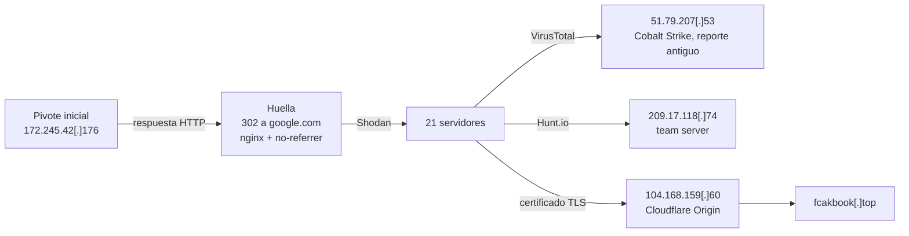

> **TLP:CLEAR** · Confianza global: **media** · Investigación: agosto-septiembre de 2026 · Última actualización: 2026-11-07
{: .prompt-info .notranslate translate="no" }

## Ideas clave

Partiendo de la IP `172.245.42[.]176`{: .notranslate translate="no"}, he construido una huella de su respuesta HTTP: un **302 hacia `https://www.google.com/`** servido por **nginx**, con un `Content-Length` concreto y la cabecera `Referrer-Policy: no-referrer`. Esa huella devuelve **21 servidores** en Shodan, concentrados en Hostwinds, OVH Singapur y Cluster Logic.

Varios resultados ya están vinculados públicamente a **Cobalt Strike**: Hunt.io identifica `209.17.118[.]74`{: .notranslate translate="no"} como *team server*, y en VirusTotal hay un reporte antiguo de un servidor de Cobalt Strike en `51.79.207[.]53`{: .notranslate translate="no"}. Además, `104.168.159[.]60`{: .notranslate translate="no"} presenta un **certificado de Cloudflare Origin**: es el origen de un redirector que se esconde detrás de Cloudflare.

Mi evaluación es que el clúster corresponde, **con confianza media**, a redirectores de infraestructura de post-explotación, con Cobalt Strike como candidato principal. La huella es eficaz pero se basa en un comportamiento relativamente genérico de nginx, y la atribución de cada IP requiere validación adicional.

## Contexto: redirectores de Cobalt Strike

En una operación con Cobalt Strike, el *team server* (el servidor de C2 real) casi nunca se expone directamente. Entre él y los equipos infectados se colocan **redirectores**: servidores intermedios, a menudo un nginx o un Apache baratos, que:

- **reenvían al team server solo el tráfico que coincide con el perfil del beacon** (rutas, cabeceras o *User-Agent* concretos), y
- **redirigen todo lo demás a un sitio legítimo**, como Google, para que un analista o un escáner que visite la IP vea algo inocuo.

Ese segundo comportamiento es el que permite cazarlos. La respuesta "señuelo" suele estar configurada con prisas y de la misma manera en todos los redirectores de un operador, lo que la convierte en una **huella reutilizable**. Hunt.io describió una técnica parecida en 2024: servidores de Earth Baxia y PlugX quedaron expuestos por sus redirecciones señuelo hacia sitios conocidos y por sus certificados, incluidos certificados de Cloudflare Origin.

## Punto de partida

El indicador de pivote inicial es `172.245.42[.]176`{: .notranslate translate="no"}. Al consultarlo, el **17 de agosto de 2026** respondió así:

```http
HTTP/1.1 302 Moved Temporarily
Server: nginx
Date: Mon, 17 Aug 2026 17:44:49 GMT
Content-Type: text/html
Content-Length: 138
Connection: keep-alive
Location: https://www.google.com/
Referrer-Policy: no-referrer
```
{: .notranslate translate="no" }

Cada línea aporta algo a la huella:

| Elemento | Qué indica |
|---|---|
| `302 Moved Temporarily` + `Location: https://www.google.com/` | Redirección señuelo hacia un sitio legítimo, típica de un redirector |
| `Server: nginx` sin versión | nginx con `server_tokens off` |
| `Content-Length: 138` | Tamaño exacto de la página 302 por defecto de nginx sin versión (ver abajo) |
| `Referrer-Policy: no-referrer` | Cabecera añadida a mano en la configuración. Es poco habitual en una redirección y **reduce mucho los falsos positivos** |
{: .notranslate translate="no" }

### Por qué 138 y 154 bytes

nginx genera automáticamente una pequeña página HTML para cada redirección. He calculado su tamaño:

- **Sin versión** (`<hr><center>nginx</center>`): **138 bytes**, exactamente el del pivote inicial.
- **Con una versión de 21 caracteres**, como `nginx/1.18.0 (Ubuntu)`: **154 bytes**, el segundo valor de la consulta.

Esto tiene una consecuencia práctica: el `Content-Length` no identifica al operador por sí solo, sino **la configuración por defecto de nginx**. Lo que acota la búsqueda es la **combinación** con el destino de la redirección y la cabecera `Referrer-Policy`.

## Metodología de pivoting

<div class="notranslate" translate="no" markdown="1">



</div>

### 1. Huella HTTP en Shodan

Con los elementos de la respuesta construí esta consulta:

```text
HTTP/1.1 302 Moved Temporarily Server: nginx Content-Type: text/html
("Content-Length:138" OR "Content-Length:154") Connection: keep-alive
"Location: https://www.google.com/" Referrer-Policy: no-referrer
```
{: .notranslate translate="no" }

Devolvió **21 resultados**.

{: width="1299" height="839" }
_21 servidores con la misma respuesta 302: distribución por país, puerto y proveedor_

### 2. Enriquecimiento de los resultados

Revisé los resultados en fuentes de reputación para ver si alguno ya estaba vinculado a infraestructura conocida:

- **`51.79.207[.]53`{: .notranslate translate="no"}** (OVH Singapur): 4 de 90 motores lo marcan como malicioso en VirusTotal. Un comentario de la comunidad de **hace unos dos años** lo describe como servidor de Cobalt Strike en el puerto 81, con rutas que imitan a jQuery y el *watermark* `391144938`.
- **`209.17.118[.]74`{: .notranslate translate="no"}** (Leaseweb Singapur): Hunt.io lo clasifica como **team server de Cobalt Strike**, con una detección reciente en el momento de la consulta.

{: width="700" }
_Comentario de la comunidad en VirusTotal: servidor de Cobalt Strike en 51.79.207[.]53, hace unos dos años_

{: width="1000" }
_Hunt.io identifica 209.17.118[.]74 como team server de Cobalt Strike_

## Hallazgos

### Distribución de la infraestructura

| Dimensión | Resultado |
|---|---|
| Países | Estados Unidos (9), Países Bajos (4), Singapur (4), Alemania (2), China (1) |
| Puertos | 443 (12), 80 (9) |
| Proveedores principales | Hostwinds Seattle (7), Cluster Logic (2), OVH Singapur (2) |

Predominan los **VPS baratos y de alta rotación**, sobre todo Hostwinds, algo habitual en infraestructura de redirección: se crea y se destruye con facilidad y no expone el team server.

### Un redirector detrás de Cloudflare

`104.168.159[.]60`{: .notranslate translate="no"} presenta un **certificado de Cloudflare Origin** (emitido por CloudFlare, Inc., con el nombre común *CloudFlare Origin Certificate*) y se asocia al dominio `fcakbook[.]top`{: .notranslate translate="no"}, un nombre que recuerda a Facebook.

Un certificado de Cloudflare Origin **solo tiene sentido en un servidor que recibe tráfico a través de Cloudflare**: los navegadores no confían en él directamente. Que un escáner lo vea al conectarse a la IP indica dos cosas:

1. **El redirector es el origen de un dominio protegido por Cloudflare.** Las víctimas, o los beacons, se conectan a Cloudflare, y Cloudflare reenvía el tráfico a esta IP. Esto oculta la IP real y hace que el tráfico parezca dirigido a la red de Cloudflare.
2. **El origen no está bien aislado.** Si el servidor solo aceptara conexiones desde los rangos de Cloudflare, ningún escáner podría haber visto el certificado. Es un descuido del operador y un **pivote de hunting** útil.

### Lo que implican los puertos de Cloudflare

Cloudflare solo actúa como proxy de tráfico HTTP y HTTPS en una lista cerrada de puertos (salvo con Spectrum, que es exclusivo del plan Enterprise):

| Protocolo | Puertos |
|---|---|
| HTTP | 80, 8080, 8880, 2052, 2082, 2086, 2095 |
| HTTPS | 443, 2053, 2083, 2087, 2096, 8443 |
{: .notranslate translate="no" }

Para el hunting, esto tiene dos consecuencias:

- **Un listener de Cobalt Strike detrás de Cloudflare tiene que usar alguno de estos puertos.** Los dos que dominan en los resultados, 443 y 80, son compatibles. Merece la pena repetir la consulta con los puertos alternativos (`8443`, `2053`, `2083`, `8080`, `8880`…), que los operadores usan para pasar más desapercibidos.
- **El puerto 81 no está en la lista.** El reporte antiguo sobre `51.79.207[.]53` describía un listener en el puerto 81, así que en aquel momento ese servidor no podía estar detrás de Cloudflare: se exponía directamente. Su configuración actual puede ser otra.

### Cronología

| Fecha | Evento |
|---|---|
| ~2024 | Reporte de la comunidad en VirusTotal: servidor de Cobalt Strike en `51.79.207[.]53` (puerto 81) |
| 2026-08-17 | Respuesta HTTP del indicador pivote inicial `172.245.42[.]176` |
| 2026-09-03 | Shodan observa la huella en `51.79.207[.]53` |
| 2026-09-04 | Shodan observa la huella en `23.254.202[.]110` |
| 2026-09-05 | Shodan observa la huella en `104.168.159[.]60` (certificado de Cloudflare Origin). Cierre de la investigación |
{: .notranslate translate="no" }

## Indicadores

Todos los indicadores están **defangeados**. No incluyo los nombres de host rDNS de los proveedores (por ejemplo, `*.hostwindsdns.com`): identifican el VPS alquilado, no al operador.



📥 [Descargar IOCs en CSV]({{ '/assets/iocs/cs-redirectors-nginx.csv' | relative_url }})

## Mapeo MITRE ATT&CK

| Técnica | Nombre | Fuente |
|---|---|---|
| [T1583.003](https://attack.mitre.org/techniques/T1583/003/) | Acquire Infrastructure: Virtual Private Server | Observado (Hostwinds, OVH, Leaseweb) |
| [T1583.001](https://attack.mitre.org/techniques/T1583/001/) | Acquire Infrastructure: Domains | Observado (`fcakbook[.]top`) |
| [T1090.002](https://attack.mitre.org/techniques/T1090/002/) | Proxy: External Proxy | Observado (redirectores) |
| [T1665](https://attack.mitre.org/techniques/T1665/) | Hide Infrastructure | Observado (302 señuelo y Cloudflare) |
| [T1071.001](https://attack.mitre.org/techniques/T1071/001/) | Application Layer Protocol: Web Protocols | Reportado (VirusTotal, Hunt.io) |

"Observado" significa visible en la infraestructura analizada; "Reportado" significa que procede de la fuente indicada y no lo he verificado yo.

## Hunting / detección

### Infraestructura (Shodan)

- **Huella principal**: la consulta de la sección *Metodología de pivoting*.
- **Origen detrás de Cloudflare**: añade el certificado a la huella para encontrar otros orígenes mal aislados:

  ```text
  "Location: https://www.google.com/" "Referrer-Policy: no-referrer" ssl.cert.subject.cn:"CloudFlare Origin Certificate"
  ```
  {: .notranslate translate="no" }

- **Puertos alternativos de Cloudflare**: repite la huella filtrando por los puertos que Cloudflare acepta además de 80 y 443:

  ```text
  "Location: https://www.google.com/" "Referrer-Policy: no-referrer" port:8443,2053,2083,2087,2096,8080,8880,2052,2082,2086,2095
  ```
  {: .notranslate translate="no" }

La sintaxis de Shodan puede cambiar y no todos los filtros están disponibles en todos los planes; comprueba estas consultas en tu cuenta antes de automatizarlas.

### Red y endpoint (para defensores)

- **Conexiones salientes** hacia las IPs de la tabla de indicadores: busca en los logs de firewall y proxy de los últimos 90 días. Un beacon de Cobalt Strike genera conexiones periódicas y regulares (*beaconing*), más fáciles de distinguir del tráfico humano que una visita aislada.
- **El dominio `fcakbook[.]top`** en logs de DNS y proxy. Si el redirector está detrás de Cloudflare, la conexión irá a una IP de Cloudflare, así que **el dominio es más útil que la IP** para detectarlo.
- **Watermark `391144938`**: si analizas configuraciones de beacons extraídas de muestras o de memoria, este *watermark* permite relacionarlas con el servidor reportado en `51.79.207[.]53`. Ten en cuenta que muchas copias no oficiales de Cobalt Strike comparten *watermark*, así que no es una atribución por sí sola.

### Mitigación

- **Bloquea los indicadores de confianza alta y media** en el perímetro, revisando antes que no haya tráfico legítimo hacia ellos (sobre todo en el caso de IPs de proveedores de VPS compartidos).
- **No bloquees por la huella HTTP**: un 302 a Google no es malicioso en sí mismo. La huella sirve para **descubrir infraestructura**, no para filtrar tráfico.

## Limitaciones y nivel de confianza

- **La huella se apoya en un comportamiento por defecto de nginx.** El `Content-Length` de 138 o 154 bytes lo produce cualquier nginx que redirija con su página estándar. La combinación con el destino de la redirección y `Referrer-Policy: no-referrer` reduce los falsos positivos, pero no los elimina: algunos de los 21 resultados pueden ser servidores sin relación con Cobalt Strike.
- **Atribución desigual.** Solo dos de los 21 servidores tienen corroboración externa, y una de ellas (`51.79.207[.]53`) es un reporte de hace unos dos años. Las IPs de VPS cambian de cliente con frecuencia, así que la actividad antigua no implica que el servidor siga siendo del mismo operador.
- **Un mismo operador no está demostrado.** La huella indica una **configuración común**, que puede proceder de una guía o un script de despliegue compartido por varios actores, no necesariamente de un único grupo.
- **Operadores booleanos en Shodan.** No he verificado por separado cuántos resultados aporta cada variante de `Content-Length`. Conviene ejecutar las dos consultas por separado para confirmar que ambas funcionan.
- **Visibilidad parcial.** Shodan solo ve lo que escanea, en los puertos que escanea y en el momento en que lo hace. Los redirectores bien aislados detrás de Cloudflare son, por definición, invisibles para esta técnica.
- **Investigación pasiva.** No he interactuado con los servidores más allá de lo que muestran los escáneres públicos, ni he obtenido configuraciones de beacons.

## Referencias

- Shodan, búsqueda por la huella HTTP descrita en este artículo
- VirusTotal, [51.79.207.53](https://www.virustotal.com/gui/ip-address/51.79.207.53/community) y [209.17.118.74](https://www.virustotal.com/gui/ip-address/209.17.118.74/detection)
- Cloudflare, [Network ports](https://developers.cloudflare.com/fundamentals/reference/network-ports/)
- Hunt.io, [Unmasking adversary infrastructure: how certificates and redirects exposed Earth Baxia and PlugX activity](https://hunt.io/blog/unmasking-adversary-infrastructure-how-certificates-and-redirects-exposed-earth-baxia-and-plugx-activity), 10 de octubre de 2024
- MITRE ATT&CK, [T1090.002 – Proxy: External Proxy](https://attack.mitre.org/techniques/T1090/002/) y [T1665 – Hide Infrastructure](https://attack.mitre.org/techniques/T1665/)

