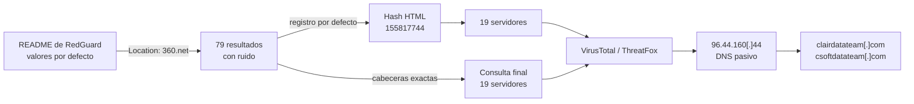

> **TLP:CLEAR** · Confianza global: **alta** en la identificación de RedGuard, **media** en la actividad maliciosa · Investigación: julio de 2026 · Última actualización: 2026-11-07
{: .prompt-info .notranslate translate="no" }

## Ideas clave

**RedGuard** es una herramienta de código abierto que se coloca delante de un servidor de mando y control (C2), normalmente Cobalt Strike, y decide qué tráfico deja pasar. A diferencia del post anterior sobre redirectores nginx, aquí **no partí de un indicador**, sino de la **documentación de la propia herramienta**: sus valores por defecto dejan una huella reconocible.

Combinando la redirección por defecto (un **307 hacia `https://360.net`**) con los detalles de la respuesta HTTP, construí una consulta que devuelve **19 servidores** en Shodan, concentrados en Hong Kong, Estados Unidos y China. Casi todos tienen reportes previos en VirusTotal, y al menos uno está etiquetado expresamente como RedGuard en ThreatFox.

Además, el análisis de la huella revela dos detalles útiles para el hunting:

- El **certificado TLS por defecto**, que suplanta a Alibaba Cloud, tiene un número de serie que equivale a su **fecha de creación en nanosegundos** (14 de julio de 2022). Si se reutiliza en todos los despliegues, ese serial basta para encontrarlos.
- El `Content-Length: 51` lo produce la función de redirección estándar de **Go**, y depende solo de la longitud de la URL de destino. Eso permite **adaptar la huella** si el operador cambia el destino.

Identifico estos servidores como RedGuard **con confianza alta**. Que su uso sea malicioso tiene **confianza media**: RedGuard también lo usan equipos de red team en ejercicios autorizados.

## Contexto: qué es RedGuard

RedGuard es un **redirector de C2 con control de flujo**, publicado en GitHub por wikiZ. Se coloca entre los equipos infectados y el servidor de C2 real y filtra las conexiones antes de reenviarlas. Según su documentación, puede bloquear o desviar tráfico por:

- **Ubicación de la IP** de origen.
- **Franja horaria** permitida.
- **Listas negras**, por ejemplo de proveedores cloud y sandboxes.
- **Inspección de la petición**, para comprobar que coincide con el perfil del beacon.

El objetivo es que **solo los beacons legítimos lleguen al C2**, mientras que analistas, sandboxes y escáneres reciben una respuesta inocua. Es la misma idea que el redirector nginx del post anterior, pero automatizada y con más criterios de filtrado.

Esa respuesta inocua es precisamente lo que permite cazarlo. Hunt.io lo explicó en 2024: los valores por defecto de RedGuard permiten detectarlo, aunque la técnica, en sus palabras, solo atrapa a los adversarios "perezosos" que no los cambian.

## Punto de partida

En lugar de un indicador, el punto de partida fue el README del repositorio ([versión consultada](https://github.com/wikiZ/RedGuard/tree/588f3faeccb186c046ae7ebe4f03b9870a293c21)), que describe tres valores por defecto relevantes:

1. **Redirección** del tráfico rechazado a puertos locales o a un sitio de 360, el proveedor de seguridad chino.
2. **Certificado TLS** generado con los datos de **Alibaba (China) Technology Co., Ltd.**
3. **Huella JARM aleatoria** en cada arranque. Esto descarta JARM como pivote.

Una primera búsqueda en Shodan por `Location: https://360.net` devolvió **79 resultados**. Muchos no tenían relación con RedGuard (por ejemplo, un WAF comercial), pero el segundo mostraba la configuración por defecto completa:

{: width="1407" height="741" }
_79 servidores redirigen a https://360.net; el segundo resultado muestra la configuración por defecto de RedGuard_

```http
HTTP/1.1 307 Temporary Redirect
Content-Type: text/html; charset=utf-8
Location: https://360.net
Date: Sun, 26 Jul 2026 10:24:21 GMT
Content-Length: 51
```
{: .notranslate translate="no" }

```text
Serial Number: 1657766544761773100 (0x170191e3a50d5c2c)
Issuer:  C=CN, L=HangZhou, O=Alibaba (China) Technology Co., Ltd., CN=*.aliyun.com
Subject: C=CN, L=HangZhou, O=Alibaba (China) Technology Co., Ltd., CN=*.aliyun.com
Validity: Jul 14 02:42:24 2022 GMT → Jul 14 02:42:24 2023 GMT
```
{: .notranslate translate="no" }

### Qué delata cada elemento

| Elemento | Qué indica |
|---|---|
| `307 Temporary Redirect` a `https://360.net` | Redirección por defecto de RedGuard |
| `Content-Type: text/html; charset=utf-8` + `Content-Length: 51` | Respuesta generada por la función `http.Redirect` de Go (ver abajo) |
| Certificado `*.aliyun.com` **autofirmado** (emisor = sujeto) | Certificado falso. Los certificados reales de Alibaba Cloud los emite una CA pública, no se firman a sí mismos |
| Validez **2022-2023** | Certificado **caducado** desde hace tres años, servido en 2026 |
| Serial `1657766544761773100` | Marca de tiempo de creación (ver abajo) |
{: .notranslate translate="no" }

### Por qué 51 bytes

Cuando un programa en Go redirige con `http.Redirect`, devuelve un pequeño cuerpo HTML con este formato:

```html
<a href="https://360.net">Temporary Redirect</a>.
```
{: .notranslate translate="no" }

seguido de dos saltos de línea. Son **exactamente 51 bytes**: **36 fijos más la longitud de la URL** (`https://360.net` tiene 15). Lo he comprobado ejecutando `http.Redirect` con Go 1.24: devuelve el mismo código 307, el mismo `Content-Type` y 51 bytes. Esto tiene dos consecuencias:

- **Confirma que el servidor está escrito en Go**, como RedGuard.
- **Permite adaptar la huella** si el operador cambia el destino: `Content-Length` = 36 + longitud de la nueva URL.

### Por qué el serial es una fecha

El número de serie `1657766544761773100`, leído como **nanosegundos desde 1970**, corresponde al **14 de julio de 2022, 02:42:24.76 UTC**: el mismo instante que el inicio de validez del certificado. Es decir, el serial se generó a partir del reloj en el momento de crear el certificado.

Que un servidor observado en **julio de 2026** presente un certificado creado en **julio de 2022** sugiere que el certificado **no se genera en cada despliegue**, sino que se reutiliza el mismo. Si es así, el serial es un pivote casi perfecto. No he podido comprobar en el código de RedGuard de dónde sale ese certificado, así que lo trato como **hipótesis** (ver *Limitaciones*).

## Metodología de pivoting

<div class="notranslate" translate="no" markdown="1">



</div>

### 1. Pivote por el hash del cuerpo HTML

Shodan calcula un hash del cuerpo de cada respuesta. El de la redirección por defecto, `http.html_hash:155817744`, aparece en **19 servidores**:

{: width="1465" height="870" }
_19 servidores con el mismo cuerpo HTML: Hong Kong, Estados Unidos y China; puertos 80, 443 y 8080_

### 2. Consulta por cabeceras

En paralelo, construí una consulta con los valores exactos de la respuesta:

```text
HTTP/1.1 307 Temporary Redirect Content-Type: text/html; charset=utf-8
Location: https://360.net Content-Length: 51
```
{: .notranslate translate="no" }

Devuelve también **19 resultados** (julio de 2026), lo que coincide con el pivote por hash.

### 3. Pruebas para ampliar la huella

Como el destino y el certificado se pueden cambiar, probé a quitar esos elementos para encontrar despliegues personalizados:

| Variante | Resultados | Problema |
|---|---|---|
| Sin `Location` (solo 307 + `charset=utf-8`) | **4.555** | Demasiado amplia: cualquier servicio en Go que redirija con 307 coincide |
| Añadiendo el emisor `*.aliyun.com` | **8** | Demasiado estricta: probablemente porque descarta los servidores que solo escuchan por HTTP (puerto 80), que no tienen certificado |
{: .notranslate translate="no" }

La conclusión es que **la mayoría de los operadores despliegan RedGuard con la configuración por defecto**, así que la consulta exacta es la que mejor equilibra precisión y cobertura.

## Hallazgos

### Distribución de la infraestructura

| Dimensión | Resultado (19 servidores) |
|---|---|
| Países | Hong Kong (11), Estados Unidos (5), China (3) |
| Puertos | 80 (11), 443 (7), 8080 (1) |
| Proveedores principales | Hong Kong YunLiFang (3), HostPapa (3), APEX SPEED (2), APNIC (2), Tencent Cloud (2) |

Destaca el peso de **Hong Kong y de proveedores asiáticos**, coherente con el origen de la herramienta, cuya documentación está en chino e inglés. Esto **no basta para atribuir** los servidores a actores de una región concreta: es una herramienta pública que cualquiera puede desplegar en cualquier proveedor.

### Corroboración externa

Casi todos los servidores tienen reportes previos en VirusTotal. Algunos ejemplos:

- **`124.156.152[.]46`{: .notranslate translate="no"}** (Tencent, Hong Kong): reportado hace aproximadamente un año en ThreatFox como C2, con la etiqueta **RedGuard**. Es la corroboración más directa.
- **`45.137.10[.]110`{: .notranslate translate="no"}** (XNNET, Hong Kong): 9 de 91 motores lo marcan como malicioso; reportado en ThreatFox como *botnet_cc* de malware sin identificar, visto por primera vez el 3 de octubre de 2025.
- **`82.156.238[.]106`{: .notranslate translate="no"}** (Tencent Cloud, Pekín): AlphaSOC lo clasifica como malware.

{: width="1000" }
_124.156.152[.]46, reportado en ThreatFox como C2 con la etiqueta #RedGuard_

### Dominios asociados a 96.44.160.44

`96.44.160[.]44`{: .notranslate translate="no"} (HostPapa, Los Ángeles), el servidor que mostraba la configuración por defecto completa, tiene historial de **DNS pasivo** en VirusTotal:

- `clairdatateam[.]com` (8 de 91 detecciones), `www.clairdatateam[.]com` (6 de 91) y `ht.clairdatateam[.]com`, en octubre de 2025.
- `csoftdatateam[.]com` y `www.csoftdatateam[.]com` (0 de 91), también en octubre de 2025.

{: width="1000" }
_Dominios que resolvieron a 96.44.160[.]44 en octubre de 2025_

Los dos dominios siguen el mismo patrón de nombre (`*datateam.com`), lo que sugiere un mismo operador. Pero las resoluciones son **nueve meses anteriores** a mi observación, así que pueden corresponder a un uso anterior de la IP.

### Cronología

| Fecha | Evento |
|---|---|
| 2022-07-14 | Creación del certificado por defecto (`Not Before` y serial) |
| 2023-07-14 | Caduca el certificado por defecto |
| 2024-04-02 | Hunt.io publica su guía para detectar RedGuard por sus valores por defecto |
| ~2025 | ThreatFox reporta `124.156.152[.]46` como C2 con la etiqueta RedGuard |
| 2025-10-03 | ThreatFox ve por primera vez `45.137.10[.]110` como *botnet_cc* |
| 2025-10-15 / 21 | `clairdatateam[.]com` y `csoftdatateam[.]com` resuelven a `96.44.160[.]44` |
| 2026-07-25 / 26 | Shodan observa la huella por defecto en `82.156.238[.]106` y `96.44.160[.]44`. Cierre de la investigación |
{: .notranslate translate="no" }

## Indicadores

Todos los indicadores están **defangeados**. Incluyo también el serial del certificado y el hash HTML de Shodan, que son los pivotes más duraderos.



📥 [Descargar IOCs en CSV]({{ '/assets/iocs/redguard-default.csv' | relative_url }})

## Mapeo MITRE ATT&CK

| Técnica | Nombre | Fuente |
|---|---|---|
| [T1588.002](https://attack.mitre.org/techniques/T1588/002/) | Obtain Capabilities: Tool | Observado (RedGuard, código abierto) |
| [T1583.003](https://attack.mitre.org/techniques/T1583/003/) | Acquire Infrastructure: Virtual Private Server | Observado |
| [T1583.001](https://attack.mitre.org/techniques/T1583/001/) | Acquire Infrastructure: Domains | Observado vía DNS pasivo (`*datateam.com`) |
| [T1090.002](https://attack.mitre.org/techniques/T1090/002/) | Proxy: External Proxy | Observado (redirector) |
| [T1665](https://attack.mitre.org/techniques/T1665/) | Hide Infrastructure | Observado (redirección señuelo y filtrado de analistas y sandboxes) |
| [T1071.001](https://attack.mitre.org/techniques/T1071/001/) | Application Layer Protocol: Web Protocols | Reportado (ThreatFox) |

"Observado" significa visible en la infraestructura analizada; "Reportado" significa que procede de la fuente indicada y no lo he verificado yo.

## Hunting / detección

### Infraestructura (Shodan)

**Configuración por defecto**, la más precisa:

```text
HTTP/1.1 307 Temporary Redirect Content-Type: text/html; charset=utf-8 Location: https://360.net Content-Length: 51
```
{: .notranslate translate="no" }

**Cuerpo HTML por defecto:**

```text
http.html_hash:155817744
```
{: .notranslate translate="no" }

**Certificado por defecto.** Un `*.aliyun.com` autofirmado no es un certificado real de Alibaba Cloud:

```text
ssl.cert.subject.cn:"*.aliyun.com" ssl.cert.issuer.cn:"*.aliyun.com"
```
{: .notranslate translate="no" }

**Serial del certificado**, si se confirma que se reutiliza:

```text
ssl.cert.serial:1657766544761773100
```
{: .notranslate translate="no" }

**Destino personalizado.** Si un operador cambia la URL de redirección, el `Content-Length` pasa a ser 36 más la longitud de la nueva URL. Por ejemplo, para `https://www.baidu.com` (21 caracteres), sería 57:

```text
HTTP/1.1 307 Temporary Redirect Content-Type: text/html; charset=utf-8 Location: https://www.baidu.com Content-Length: 57
```
{: .notranslate translate="no" }

La sintaxis de los filtros de Shodan puede variar entre planes; comprueba estas consultas en tu cuenta antes de automatizarlas.

### Red y endpoint (para defensores)

- **Conexiones salientes** hacia las IPs de la tabla de indicadores en los logs de firewall y proxy. Busca patrones periódicos, típicos de un beacon.
- **Los dominios `clairdatateam[.]com` y `csoftdatateam[.]com`** en logs de DNS y proxy.
- **Ten en cuenta el filtrado de RedGuard al analizar un incidente.** Si visitas un C2 sospechoso desde tu red o lo detonas en un sandbox y solo ves una redirección a 360.net, **eso no descarta que sea malicioso**: es justo el comportamiento esperado. La respuesta señuelo es, de hecho, un indicador.

### Mitigación

- **Bloquea los indicadores de confianza alta y media** en el perímetro, revisando antes que no haya tráfico legítimo hacia ellos.
- **Si tu organización contrata ejercicios de red team**, confirma con el equipo responsable si alguna de estas IPs es suya antes de abrir un incidente.

## Limitaciones y nivel de confianza

- **Solo detecta despliegues por defecto.** Como advierte Hunt.io, un operador que cambie el destino, el certificado y los puertos deja de coincidir. La fórmula del `Content-Length` ayuda con destinos personalizados, pero no con todo lo demás.
- **RedGuard no es malware.** Es una herramienta de red team publicada en abierto. Los 19 servidores ejecutan RedGuard **con confianza alta**, pero que formen parte de una operación maliciosa tiene **confianza media**: algunos pueden ser ejercicios autorizados.
- **Reutilización del certificado no verificada.** No he podido revisar el código de RedGuard para confirmar si el certificado de 2022 viene incluido en el proyecto o si este servidor lo conserva de un despliegue antiguo. Antes de usar el serial como pivote principal, conviene comprobar que aparece en varios servidores distintos.
- **JARM no sirve.** Según la documentación, RedGuard aleatoriza su huella JARM en cada arranque.
- **Indicadores con fechas distintas.** Los dominios y varios reportes de ThreatFox son de 2025, anteriores a mi observación de julio de 2026. Las IPs pueden haber cambiado de uso desde entonces.
- **Visibilidad parcial.** Shodan solo ve lo que escanea, en los puertos que escanea. Un RedGuard que filtre a los escáneres por su IP de origen sería invisible para esta técnica.
- **Investigación pasiva.** No he interactuado con los servidores más allá de lo que muestran los escáneres públicos.

## Referencias

- wikiZ, [RedGuard en GitHub](https://github.com/wikiZ/RedGuard) ([versión del README consultada](https://github.com/wikiZ/RedGuard/tree/588f3faeccb186c046ae7ebe4f03b9870a293c21))
- Hunt.io, [A Hunt how-to: detecting RedGuard C2 redirector](https://hunt.io/blog/detecting-redguard-c2-redirector), 2 de abril de 2024
- Shodan, búsquedas por la huella descrita en este artículo y por `http.html_hash:155817744`
- VirusTotal, [96.44.160.44](https://www.virustotal.com/gui/ip-address/96.44.160.44/relations), [124.156.152.46](https://www.virustotal.com/gui/ip-address/124.156.152.46/community), [45.137.10.110](https://www.virustotal.com/gui/ip-address/45.137.10.110/community) y [82.156.238.106](https://www.virustotal.com/gui/ip-address/82.156.238.106/detection)
- ThreatFox (abuse.ch), [IOC 1402481](https://threatfox.abuse.ch/ioc/1402481/)
- MITRE ATT&CK, [T1588.002 – Obtain Capabilities: Tool](https://attack.mitre.org/techniques/T1588/002/) y [T1665 – Hide Infrastructure](https://attack.mitre.org/techniques/T1665/)

