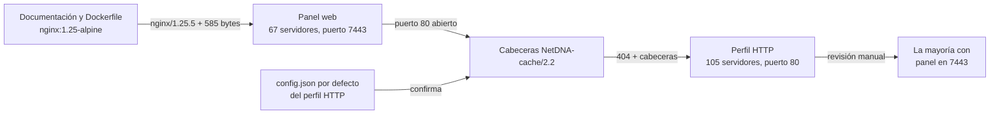

> **TLP:CLEAR** · Confianza global: **media** · Investigación: agosto de 2026 · Última actualización: 2026-11-08
{: .prompt-info .notranslate translate="no" }

## Ideas clave

**Mythic** es un framework de C&C de código abierto para equipos de red team. Como en el post sobre RedGuard, aquí el punto de partida no es un indicador, sino la **documentación y el código del propio proyecto**, que revelan dos huellas independientes:

1. **El panel web del operador** (puerto **7443**), servido por un **nginx 1.25.5** con una página de **585 bytes**. Esta huella devuelve **67 servidores** en Shodan, casi todos en el 7443 y con certificados emitidos por "Mythic".
2. **El perfil HTTP por defecto** (puerto **80**), el servicio al que se conectan los agentes. Responde con un **`404` vacío** y una cabecera **`Server: NetDNA-cache/2.2`** que imita a una CDN. Esta huella devuelve **105 servidores**, y en la mayoría el panel también estaba expuesto en el 7443.

La segunda huella es la más útil para un defensor: encuentra servidores de Mythic **aunque el operador haya ocultado el panel**, y corresponde justo al servicio con el que hablan los equipos infectados.

Identifico los paneles como Mythic con **confianza alta**. Los servidores encontrados por el perfil HTTP, con **confianza media**, porque esa huella se basa en cabeceras que no son exclusivas de Mythic. Como siempre con las herramientas de red team, que el uso sea malicioso tiene una confianza menor.

## Contexto: qué es Mythic

Mythic es una plataforma de C2 **multiusuario y modular** para operaciones de red team, publicada en GitHub por its-a-feature. Sus componentes se ejecutan como **contenedores Docker**:

- **El servidor de Mythic**, con una interfaz web para los operadores. En la práctica, Team Cymru observó en 2022 que alrededor del **90 % de los servidores expuestos** mantenía la configuración por defecto: el panel en el **puerto 7443** y un certificado TLS con la organización **"Mythic"**.
- **Los perfiles de C2**, contenedores separados que reciben las conexiones de los agentes y las reenvían a Mythic. El perfil **HTTP** es el más sencillo: peticiones GET y POST asíncronas.
- **Los agentes**, que se instalan por separado y se ejecutan en los equipos comprometidos.

Esa separación entre panel y perfil es la clave de esta investigación: son **dos servicios distintos, con dos huellas distintas**, y pueden estar o no en el mismo servidor.

En cuanto a su uso, Team Cymru documentó en 2022 **76 servidores de Mythic expuestos** y varios casos con posibles vínculos a actividad maliciosa, incluido un panel con una imagen relacionada con las filtraciones de Conti. Ellos mismos calificaron con confianza baja sus vínculos con operadores de e-crimen.

## Punto de partida

El punto de partida fue la propia documentación de Mythic:

- La [guía de actualización a Mythic 2.2](https://docs.mythic-c2.net/updating/mythic-2.1-greater-than-2.2-updates#nginx) describe un componente **nginx** delante del panel.
- El [`Dockerfile` de ese componente](https://github.com/its-a-feature/Mythic/blob/e37e057a897e4dee8b6dcedefaff1580b857803c/nginx-docker/Dockerfile) usa la imagen **`nginx:1.25-alpine`**, que en [Docker Hub](https://hub.docker.com/layers/library/nginx/1.25-alpine/images/sha256-721fa00bc549df26b3e67cc558ff176112d4ba69847537766f3c28e171d180e7) corresponde a **nginx 1.25.5**.

Es decir: cualquier Mythic desplegado con esa versión del proyecto anuncia `Server: nginx/1.25.5`. Combinado con la página que sirve el panel, se obtiene la primera huella.

## Metodología de pivoting

<div class="notranslate" translate="no" markdown="1">



</div>

### 1. Huella del panel web

```text
HTTP/1.1 200 OK Server: nginx/1.25.5 Content-Type: text/html Content-Length: 585 Connection: keep-alive Accept-Ranges: bytes
```
{: .notranslate translate="no" }

Esta consulta devuelve **67 servidores**. Shodan les asigna el título **"Mythic"**, **61 de ellos usan el puerto 7443** y presentan certificados TLS **emitidos por la organización "Mythic"**, coherente con lo observado por Team Cymru.

{: width="1883" height="843" }
_67 servidores con la huella del panel; 61 en el puerto 7443 y con certificados de la organización "Mythic"_

Los 585 bytes no son la página por defecto de nginx (que es más grande), sino la de la interfaz de Mythic. La propia cabecera `ETag` lo confirma: nginx la construye con la fecha de modificación del archivo y su tamaño en hexadecimal, y el sufijo `-249` es exactamente **585** en hexadecimal.

### 2. Del panel al perfil HTTP

Al revisar los resultados, muchos servidores tenían también **el puerto 80 abierto**, con una respuesta llamativa:

{: width="370" }
_Puerto 80: un 404 vacío con cabeceras que imitan a la CDN NetDNA_

Esas cabeceras coinciden **exactamente** con la configuración por defecto del perfil HTTP de Mythic, documentada en su repositorio:

{: width="1000" }
_config.json del perfil HTTP: cabeceras fijas, puerto 80, sin SSL y código 404 para las peticiones que no son de un agente_

| Valor por defecto | Qué produce |
|---|---|
| `"Server": "NetDNA-cache/2.2"` | Una cabecera que imita a la CDN NetDNA |
| `"Content-Type": "application/javascript; charset=utf-8"` | Un tipo de contenido JavaScript incluso en los errores |
| `"Cache-Control"`, `"Pragma"`, `"Connection"` | El resto de cabeceras fijas |
| `"port": 80`, `"use_ssl": false` | Servicio en el puerto 80, sin cifrado |
| `"error_status_code": 404`, `"error_file_path": ""` | Un `404` sin cuerpo (`Content-Length: 0`) para lo que no es un agente |
{: .notranslate translate="no" }

### 3. Huella del perfil HTTP

```text
HTTP/1.1 404 Not Found Cache-Control: max-age=0, no-cache Connection: keep-alive Content-Type: application/javascript; charset=utf-8 Pragma: no-cache Server: NetDNA-cache/2.2 port:80
```
{: .notranslate translate="no" }

Esta consulta devuelve **105 servidores**. Revisándolos uno a uno, **la mayoría tenía también el panel en el puerto 7443**, lo que confirma que la huella apunta a Mythic.

{: width="1268" height="858" }
_105 servidores con la huella del perfil HTTP. He pixelado el primer resultado, que corresponde a una conexión residencial_

## Hallazgos

### Distribución de la infraestructura

| Dimensión | Panel web (67) | Perfil HTTP (105) |
|---|---|---|
| Países principales | EE. UU. (18), Países Bajos (8), Hong Kong (7), China (5), Alemania (5) | EE. UU. (56), Alemania (12), Hong Kong (7), Países Bajos (5), India (4) |
| Puertos | 7443 (61), 80 (2), 3000 (2), 443 (1), 8080 (1) | 80 (filtrado en la consulta) |
| Proveedores | Scaleway, Tencent Cloud, APNIC y otros | DigitalOcean (18), Amazon (27 en tres organizaciones), Microsoft (7) |

El perfil HTTP aparece sobre todo en **nubes comerciales** (DigitalOcean, AWS y Azure), donde levantar y destruir un servidor es rápido y barato. Al menos un resultado procede de una **conexión residencial**, probablemente un laboratorio personal; por eso no incluyo esa IP en los indicadores.

### Las dos huellas cuentan cosas distintas

| | Panel web (7443) | Perfil HTTP (80) |
|---|---|---|
| Para quién es | El operador | Los agentes en los equipos infectados |
| Precisión | **Alta**: título y certificado de "Mythic" | **Media**: cabeceras configurables y no exclusivas |
| Robustez | **Baja**: cambia con cada versión de nginx o de la interfaz | **Media**: depende de que no se cambie `config.json` |
| Utilidad defensiva | Localizar al operador | Detectar las conexiones de los agentes |

Que en la mayoría de los servidores del perfil HTTP el **panel también esté expuesto** indica que muchos operadores ejecutan todo en la misma máquina y abierto a Internet, **sin redirectores** delante. Es lo contrario de lo que vimos en los posts de Cobalt Strike y RedGuard.

### La fecha de cada despliegue, en la ETag

La cabecera `ETag` del panel codifica en hexadecimal la fecha de modificación de la página. En los tres primeros resultados coincide exactamente con su cabecera `Last-Modified`:

| Servidor | ETag | Fecha |
|---|---|---|
| `62.4.0[.]66` | `69e5ea46-249` | 20 de abril de 2026 |
| `43.133.165[.]151` | `6a135d43-249` | 24 de mayo de 2026 |
| `114.132.155[.]197` | `6a6efc9a-249` | 2 de agosto de 2026 |
{: .notranslate translate="no" }

Probablemente reflejan **cuándo se instaló o se construyó la interfaz en cada servidor**. Es una inferencia: depende de cómo genere Mythic esa página. Pero indica que los paneles **no comparten una imagen idéntica**, y permite ordenar los despliegues en el tiempo. Team Cymru ya usó las ETag en 2022 para relacionar servidores con configuraciones copiadas entre sí.

### Una CDN de mentira

La cabecera `Server: NetDNA-cache/2.2` imita a **NetDNA**, una CDN real (después MaxCDN, integrada en StackPath). Su objetivo es que el tráfico de los agentes parezca tráfico normal hacia una CDN. Pero en este contexto resulta contraproducente: un `404` **vacío** con tipo **JavaScript** y la cabecera de una CDN, servido por **HTTP sin cifrar** desde un VPS, es una combinación muy poco habitual en un servidor legítimo.

### Cronología

| Fecha | Evento |
|---|---|
| 2022-09-06 | Team Cymru documenta 76 servidores de Mythic expuestos, el 90 % con la configuración por defecto |
| 2026-04-20 | Fecha de la interfaz en `62.4.0[.]66` (según su ETag) |
| 2026-05-24 | Fecha de la interfaz en `43.133.165[.]151` |
| 2026-08-02 | Fecha de la interfaz en `114.132.155[.]197` |
| 2026-08-15 | Shodan observa ambas huellas. Cierre de la investigación |
{: .notranslate translate="no" }

## Indicadores

Todos los indicadores están **defangeados**. Incluyo solo una muestra de los resultados, sin IPs residenciales. Para obtener la lista completa y actualizada, usa las consultas de la sección *Hunting*.



📥 [Descargar IOCs en CSV]({{ '/assets/iocs/mythic-c2.csv' | relative_url }})

## Mapeo MITRE ATT&CK

| Técnica | Nombre | Fuente |
|---|---|---|
| [T1588.002](https://attack.mitre.org/techniques/T1588/002/) | Obtain Capabilities: Tool | Observado (Mythic, código abierto) |
| [T1583.003](https://attack.mitre.org/techniques/T1583/003/) | Acquire Infrastructure: Virtual Private Server | Observado (DigitalOcean, AWS, Azure, Scaleway, Tencent) |
| [T1071.001](https://attack.mitre.org/techniques/T1071/001/) | Application Layer Protocol: Web Protocols | Observado (perfil HTTP) |
| [T1001.003](https://attack.mitre.org/techniques/T1001/003/) | Data Obfuscation: Protocol or Service Impersonation | Observado (cabecera que imita a la CDN NetDNA) |

"Observado" significa visible en la infraestructura analizada; "Reportado" significa que procede de la fuente indicada y no lo he verificado yo.

## Hunting / detección

### Infraestructura (Shodan)

**Panel web**, la huella de la investigación:

```text
HTTP/1.1 200 OK Server: nginx/1.25.5 Content-Type: text/html Content-Length: 585 Connection: keep-alive Accept-Ranges: bytes
```
{: .notranslate translate="no" }

**Perfil HTTP por defecto**, la huella de la investigación:

```text
HTTP/1.1 404 Not Found Cache-Control: max-age=0, no-cache Connection: keep-alive Content-Type: application/javascript; charset=utf-8 Pragma: no-cache Server: NetDNA-cache/2.2 port:80
```
{: .notranslate translate="no" }

**Variantes sugeridas, sin probar**, más resistentes a los cambios de versión:

```text
http.title:"Mythic" port:7443
ssl.cert.issuer.o:"Mythic"
"Server: NetDNA-cache/2.2" "Content-Length: 0"
```
{: .notranslate translate="no" }

La primera y la segunda no dependen de la versión de nginx ni del tamaño de la interfaz. La tercera busca el perfil HTTP en cualquier puerto, no solo en el 80. La sintaxis de los filtros de Shodan puede variar entre planes; comprueba estas consultas en tu cuenta.

### Red (para defensores)

- **Tráfico HTTP sin cifrar con `Server: NetDNA-cache/2.2`** en los logs de proxy. NetDNA ya no opera como marca independiente, así que una respuesta con esa cabecera merece revisión, sobre todo si llega de un VPS y con contenido JavaScript.
- **Conexiones periódicas** hacia las IPs de la tabla de indicadores, típicas de un agente consultando tareas.
- **Si analizas un C2 sospechoso** y recibes un `404` vacío con estas cabeceras, no lo descartes: es la respuesta que da el perfil HTTP a cualquier petición que no sea de un agente.

### Mitigación

- **Bloquea los indicadores** en el perímetro tras revisar que no haya tráfico legítimo hacia ellos.
- **Si tu organización contrata ejercicios de red team**, confirma con el equipo responsable si alguna de estas IPs es suya antes de abrir un incidente.

## Limitaciones y nivel de confianza

- **La huella del panel es frágil.** Depende de una versión concreta de nginx (1.25.5) y del tamaño exacto de la interfaz (585 bytes). Una actualización de Mythic que cambie cualquiera de las dos la rompe. Las variantes por título y certificado deberían ser más estables.
- **La huella del perfil HTTP no es exclusiva.** Son cabeceras configurables que cualquiera puede copiar, y que el operador puede cambiar en `config.json`. Por eso su confianza es media. Revisé los resultados uno a uno y la mayoría tenía el panel en el 7443, pero conviene volver a validarlos.
- **Mythic no es malware.** Es una herramienta de red team de código abierto. Muchos de estos servidores pueden ser ejercicios autorizados o laboratorios personales, como sugiere el resultado residencial.
- **Sin corroboración externa sistemática.** A diferencia de los posts anteriores, no he contrastado cada IP en VirusTotal o ThreatFox.
- **Fechas de las ETag inferidas.** La relación entre la ETag y la fecha de instalación es una deducción a partir del funcionamiento de nginx, no algo documentado por Mythic.
- **Visibilidad parcial.** Shodan solo ve lo que escanea. Un operador que filtre el acceso al panel y cambie las cabeceras del perfil HTTP no aparece con estas huellas.
- **Investigación pasiva.** No he interactuado con los servidores más allá de lo que muestran los escáneres públicos.

## Referencias

- Mythic, [documentación oficial](https://docs.mythic-c2.net) y [guía de actualización a 2.2 (nginx)](https://docs.mythic-c2.net/updating/mythic-2.1-greater-than-2.2-updates#nginx)
- its-a-feature, [Mythic en GitHub](https://github.com/its-a-feature/Mythic) y [Dockerfile del componente nginx](https://github.com/its-a-feature/Mythic/blob/e37e057a897e4dee8b6dcedefaff1580b857803c/nginx-docker/Dockerfile)
- MythicC2Profiles, [perfil HTTP en GitHub](https://github.com/MythicC2Profiles/http)
- Docker Hub, [imagen nginx:1.25-alpine](https://hub.docker.com/layers/library/nginx/1.25-alpine/images/sha256-721fa00bc549df26b3e67cc558ff176112d4ba69847537766f3c28e171d180e7)
- Team Cymru, [Mythic case study: assessing common offensive security tools](https://www.team-cymru.com/post/mythic-case-study-assessing-common-offensive-security-tools), 6 de septiembre de 2022
- Shodan, búsquedas por las huellas descritas en este artículo
- MITRE ATT&CK, [T1001.003 – Protocol or Service Impersonation](https://attack.mitre.org/techniques/T1001/003/) y [T1588.002 – Obtain Capabilities: Tool](https://attack.mitre.org/techniques/T1588/002/)
