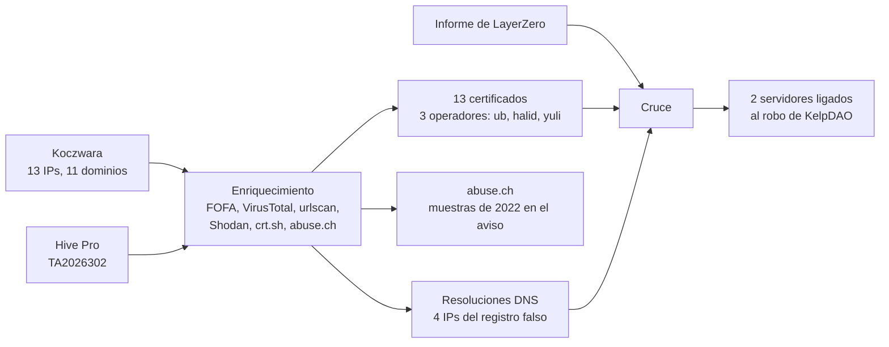

> **TLP:CLEAR** · Confianza global: **media-alta** · Investigación: noviembre de 2026 · Última actualización: 2026-11-09
{: .prompt-info .notranslate translate="no" }

> **Autoría de los indicadores de partida.** Los indicadores con los que empieza este análisis proceden de:
>
> - **Michael Koczwara** ([@MichalKoczwara](https://x.com/MichalKoczwara/status/2118432402015948849)), que el **5 de noviembre de 2026** publicó que los certificados TLS de esta infraestructura conservaban el usuario y la máquina de mkcert, junto con una lista de IPs y dominios.
> - **Hive Pro**, aviso [TA2026302](#referencias) del **15 de octubre de 2026**, que recopila los indicadores de SentinelLabs, Zscaler y otros.
>
> **Mi aportación** es el enriquecimiento de esos indicadores (FOFA, VirusTotal, urlscan, Shodan, crt.sh y abuse.ch), el cruce con el informe de LayerZero sobre el robo a KelpDAO y el análisis que sigue. En cada hallazgo indico qué es nuevo.
{: .prompt-tip }

## Ideas clave

**TraderTraitor**, el subgrupo de Lazarus que roba criptomonedas para Corea del Norte, ataca a ingenieros con acceso a la nube mediante un **proveedor falso de Terraform** que instala los backdoors **FLATROOF** y **ROOFDECK**. Michael Koczwara detectó que los certificados TLS de su infraestructura, generados con **mkcert**, conservaban el usuario y la máquina del operador: `ub@ub-Standard-PC-Q35-ICH9-2009`.

Enriqueciendo sus indicadores y los de Hive Pro, he encontrado lo siguiente, que **no aparece en ninguna de las dos fuentes**:

1. **Tres operadores, una CA.** Cada una de las 13 IPs de Koczwara presenta un certificado firmado por la CA de `ub`, pero generado por uno de **tres operadores**: `ub`, **`halid`** y **`yuli`**. Para firmar con esa CA, `halid` y `yuli` tuvieron que tener **una copia de su clave privada**. El certificado de `ub` deja además ver **las IPs privadas de su máquina virtual**.
2. **El servidor oculto tras un C2 de FLATROOF.** El certificado de `halid` en `92.242.187[.]214` incluye `arusupport-region1-webhook[.]online`, un C2 de FLATROOF que se esconde detrás de Cloudflare.
3. **Dos servidores ligados al robo de KelpDAO** (292 millones de dólares, 18 de abril de 2026): uno alojó el **C2 de FLATROOF** y otro presentaba un certificado con el **C2 de ROOFDECK** de esa intrusión. La URL del loader es **idéntica**, con el mismo identificador, en dos campañas distintas.
4. **La infraestructura del registro falso de Terraform**: cuatro IPs nuevas, incluida la usada contra LayerZero.
5. **Patrones operativos**: cuatro dominios nuevos en los **diez días** siguientes al robo, una red activa desde **febrero de 2025** y 13 de 15 IPs en el mismo proveedor.
6. **Correcciones al aviso de Hive Pro**: al menos **seis de sus once SHA256 son muestras de 2022**, no de esta campaña, y dos de sus MD5 corresponden al proveedor troyanizado y al loader (identificación que ReversingLabs confirmó después).
7. **El estado actual**: tres servidores siguen presentando la CA y otros tres **ya se han reasignado a terceros**, así que bloquearlos hoy daría falsos positivos.

> **Respecto al robo de Binance:** El **29 de octubre de 2026**, TraderTraitor robó unos **6.360 millones de dólares a Binance**, el mayor robo de criptomonedas registrado, según TRM Labs. El acceso inicial empezó con **el mismo señuelo** que esta campaña: una falsa entrevista de trabajo y un repositorio de prueba. Pero el implante fue un **pyenv troyanizado**, no el proveedor de Terraform, y **ningún indicador público une la infraestructura de este análisis con Binance**. Lo detallo en [El robo a Binance](#el-robo-a-binance-29-de-octubre-de-2026).
{: .prompt-warning }

## Contexto: TraderTraitor y el proveedor falso de Terraform

TraderTraitor (también Jade Sleet, UNC4899, Slow Pisces o PUKCHONG) es un grupo respaldado por el Estado norcoreano, activo desde al menos 2020. Hive Pro lo vincula a robos de unos **308 millones de dólares a DMM Bitcoin** (2024), **1.500 millones a Bybit** (2025) y **292 millones a KelpDAO** (2026). A esa lista se suma ahora **Binance**: unos **6.360 millones** el 29 de octubre de 2026, atribuidos al grupo por TRM Labs, Chainalysis y el FBI.

Sobre KelpDAO, **TRM Labs** atribuye el robo a Corea del Norte y describe el blanqueo como "el manual habitual de TraderTraitor": el Consejo de Seguridad de Arbitrum congeló unos 75 millones en ETH, y unos 175 millones se cambiaron a bitcoin, sobre todo a través de THORChain. Según TRM, KelpDAO y Drift Protocol (285 millones, 1 de abril, que TRM atribuye a otro grupo norcoreano distinto de TraderTraitor) sumaron el **76 % de todo lo robado en hackeos de criptomonedas hasta abril de 2026**.

La campaña funciona así, según SentinelLabs, Zscaler, LayerZero y Hive Pro:

1. **Señuelo de empleo.** Un falso reclutador propone a un ingeniero una prueba técnica en un repositorio de GitHub.
2. **Proveedor falso.** El `.terraform.lock.hcl` apunta a dominios que suplantan a HashiCorp (`hashicorp-aws[.]com`, `hashicorp-aws[.]io`, `hashicorp-terraform[.]io`). `terraform init` instala el proveedor malicioso, que descarga un loader.
3. **FLATROOF**, un backdoor que roba credenciales y monederos y exfiltra por Telegram o por un webhook.
4. **ROOFDECK**, un backdoor de control remoto que localiza su C2 mediante **Nostr** o Pastebin y solo acepta órdenes firmadas, por HTTPS con **un certificado fijado** generado con mkcert.

Hay al menos dos víctimas documentadas con esta cadena: **LayerZero**, cuyo informe del 18 de mayo de 2026 describe el acceso inicial el 6 de marzo y el robo a KelpDAO el 18 de abril, y una **empresa de servicios TI india** sin relación con las criptomonedas, analizada por SentinelLabs en septiembre.

### El robo a Binance (29 de octubre de 2026)

Diez días antes de publicar este análisis, TraderTraitor ejecutó el mayor robo de criptomonedas registrado. No forma parte de mis hallazgos, pero es imprescindible para entender a qué se dedica el grupo que está detrás de esta infraestructura.

**Qué pasó, según TRM Labs:**

- Unos **6.360 millones de dólares** salieron de carteras de Binance en **diez blockchains**, la mayor parte en unos **20 minutos** a partir de las 20:05 UTC.
- La preparación empezó **al menos 36 horas antes**: tres pequeñas retiradas de Tornado Cash financiaron la cartera del operador desde el 28 de octubre, y el código del ataque se probó en otras carteras horas antes.
- En Ethereum, el atacante usó **EIP-7702** para delegar una cartera caliente (*hot wallet*) de Binance en un contrato suyo. Una sola transacción llevaba **50 autorizaciones prefirmadas**, cada una para un *nonce* distinto. En las otras nueve cadenas hubo transferencias firmadas normales, lo que lleva a TRM a concluir que el atacante podía hacer que **el sistema de firma de las carteras calientes de Binance firmara transacciones arbitrarias**.
- Tether, Circle, Ripple, World Liberty Financial y el Consejo de Seguridad de Arbitrum congelaron **unos 2.700 millones** en pocas horas. El resto se está blanqueando con **tokens creados por el propio atacante en TRON y puentes encadenados**, según la actualización de TRM del 3 de noviembre.
- TRM atribuye el robo a TraderTraitor **con confianza alta** y señala patrones compartidos con **Bybit y KelpDAO**: retiradas pequeñas de Tornado Cash para financiar al operador, preparación previa y firmas reunidas de antemano que se ejecutan de golpe.

**Cómo entraron, según el informe preliminar de Binance** (recogido por Help Net Security y ReversingLabs):

| Fecha | Paso |
|---|---|
| Junio de 2026 | Un ingeniero de DevOps de carteras busca una herramienta de IA para programar e instala un **Homebrew manipulado** en su Mac. Binance cambia su equipo y sus credenciales, pero los atacantes ya conocen su puesto y a sus compañeros. |
| Septiembre de 2026 | Un falso "Project Director" contacta con otro ingeniero en una plataforma de empleo. Tras entrevistas con un falso responsable de RR. HH. y un falso CEO, le piden **descargar un repositorio de prueba en su ordenador de empresa**. El malware **sustituye el ejecutable de pyenv** en el directorio de Homebrew y no lo detecta la protección de endpoint. |
| 20 de octubre de 2026 | Desde ese equipo, y con una **herramienta interna de IA**, los atacantes toman el control de otros dos ingenieros. Uno tiene en su equipo un **token de despliegue de contenedores**. |
| 29 de octubre de 2026 | Despliegan un contenedor, ejecutan un script malicioso y acceden al **servicio interno de firma de carteras**. |
{: .notranslate translate="no" }

#### Qué tiene que ver con esta infraestructura

- **Coincide el método.** Falso reclutador, prueba técnica en un repositorio y ejecución en el Mac de un ingeniero con acceso privilegiado: es el mismo señuelo que la campaña del proveedor falso de Terraform.
- **No coincide el implante.** En Binance fue un **pyenv troyanizado**, no un proveedor de Terraform. ReversingLabs lo dice expresamente: **ninguna fuente vincula las herramientas de Terraform con Binance**, y no puede confirmar que los operadores sean los mismos.
- **No hay indicadores que cruzar.** Binance solo ha publicado artefactos de host, sin dominios, IPs ni hashes. Por eso **no puedo afirmar ni descartar** que la CA de mkcert, los operadores `ub`, `halid` y `yuli` o alguno de los servidores de este análisis participaran en el robo.
- **Lo que sí aporta:** confirma que TraderTraitor sigue invirtiendo en **comprometer a ingenieros a través de sus herramientas de desarrollo** (Homebrew, pyenv, Terraform), y que la detección de este análisis sigue siendo relevante.

## Punto de partida

El punto de partida es triple:

- **El certificado de la CA**, publicado por SentinelLabs e incluido por Hive Pro: emisor `mkcert ub@ub-Standard-PC-Q35-ICH9-2009`, válido desde el 20 de junio de 2025.
- **La lista de Koczwara**: 13 IPs y 11 dominios relacionados por los campos de esos certificados.
- **Los indicadores de Hive Pro**: dominios, URLs, 55 hashes y cuatro IPs.

### Por qué mkcert delata a quien lo usa

**mkcert** crea certificados de confianza para entornos de desarrollo. Por defecto escribe en ellos **el usuario y la máquina** donde se ejecuta, con el formato `usuario@máquina`:

- En el certificado de su **autoridad de certificación (CA)**, ese dato identifica a quien la creó.
- En cada **certificado de servidor** que firma esa CA, el campo de unidad organizativa (OU) identifica a quien lo generó.

En la infraestructura de un atacante, eso es un desliz de seguridad operativa (OPSEC): ambos campos viajan en cada conexión TLS y los registran los escáneres de Internet.

## Metodología

Enriquecí de forma automatizada los indicadores de partida con:

- **FOFA**, para obtener los certificados que presenta cada IP, con su OU, su número de serie y los nombres de su SAN.
- **VirusTotal**, para resoluciones DNS históricas y ficheros relacionados.
- **urlscan**, para escaneos de páginas y sus certificados.
- **Shodan**, para servicios y certificados actuales.
- **crt.sh**, para certificados públicos.
- **abuse.ch** (MalwareBazaar y ThreatFox), para muestras e indicadores conocidos.

El resultado son **201 indicadores clasificados y 563 relaciones** entre ellos. Después crucé todo con el informe de LayerZero.

<div class="notranslate" translate="no" markdown="1">



</div>

## Hallazgos

### 1. Una CA, tres operadores

**Nuevo.** FOFA muestra que **cada una de las 13 IPs de la lista de Koczwara** presentaba en el puerto 443 (10443 en un caso) un certificado firmado por la CA de `ub`. El campo OU revela quién generó cada uno, y el SAN, para qué dominio:

| Operador | IP | Dominio en el certificado |
|---|---|---|
| `ub@ub-Standard-PC-Q35-ICH9-2009` | `185.66.91[.]112` | `delay.servehttp[.]com`, `computing.servehttp[.]com` |
| | `45.11.59[.]99` | `storage.hubpage[.]cloud` |
| | `195.66.213[.]5` | `freehealth[.]lat`, `www.freehealth[.]lat` |
| | `213.111.148[.]202:10443` | Solo `localhost` y dos IPs privadas (ver abajo) |
| `halid@halid-Raider-GE78-HX-14VIG (Halid)` | `85.137.56[.]245` | `grenight[.]com` |
| | `213.111.148[.]242` | `itcy-sysvalidatorit[.]shop` |
| | `92.242.187[.]214` | `arusupport-region1-webhook[.]online` |
| `yuli@Raider-GE78-HX-14VIG (Yuli)` | `45.11.59[.]140` | `storage.hubpage[.]cloud` |
| | `78.141.211[.]155` | `storage.hubpage[.]cloud` |
| | `85.137.56[.]161` | `vaimage[.]com` |
| | `213.111.146[.]132` | `commsouthindia[.]com` |
| | `185.254.198[.]90` | `wss.sytes[.]net` |
| | `45.11.59[.]184` | `diamonddtrailers[.]com` |
{: .notranslate translate="no" }

Lo que eso significa:

- **Koczwara no encontró trece servidores sueltos, sino la infraestructura de tres personas.** `yuli` gestiona seis servidores; `ub`, cuatro; y `halid`, tres.
- **`halid` y `yuli` usan el mismo modelo de portátil**, un MSI Raider GE78 HX, según el nombre de sus máquinas. El texto entre paréntesis es el nombre completo que mkcert toma de la cuenta del sistema.
- **Para firmar con la CA de `ub`, `halid` y `yuli` necesitaban su clave privada.** mkcert firma con la CA que encuentra en su carpeta local, así que la clave se tuvo que **copiar** entre al menos tres máquinas. Es una inferencia a partir de cómo funciona mkcert, pero no hay otra forma de obtener estos certificados con la herramienta.
- **`storage.hubpage[.]cloud`, un C2 de ROOFDECK, tenía al menos tres servidores**: `45.11.59[.]140` y `78.141.211[.]155` (de `yuli`) y `45.11.59[.]99` (de `ub`). Varios operadores mantienen copias del mismo C2.
- **Todos los certificados incluyen `localhost`** en el SAN, lo habitual cuando se genera un certificado con mkcert para pruebas locales y se reutiliza en producción.
- **Es un pivote mejor que la propia CA.** Si el grupo crea una CA nueva, los nombres `halid` y `yuli` podrían seguir apareciendo en el campo OU.

#### La máquina de `ub`, al descubierto

El certificado de `ub` en `213.111.148[.]202:10443` no contiene ningún dominio. Su SAN incluye solo `localhost` y **dos IPs privadas**: `192.168.1.49` y `192.168.122.95`.

- `192.168.122.0/24` es la **red NAT por defecto de libvirt/KVM**.
- "Standard PC (Q35 + ICH9, 2009)", en el nombre de su máquina, es la descripción del tipo de máquina **Q35 de QEMU/KVM**.

Las dos pistas apuntan a lo mismo: `ub` trabaja en **una máquina virtual KVM** (`192.168.122.95`) dentro de un equipo conectado a una red local doméstica o de oficina (`192.168.1.49`). Generó ese certificado para sus propias direcciones, probablemente para hacer pruebas, y acabó expuesto en Internet.

### 2. El servidor oculto tras un C2 de FLATROOF

**Nuevo.** Según Zscaler, FLATROOF usa `arusupport-region1-webhook[.]online` como C2. Ese dominio resuelve a IPs de **Cloudflare**, que ocultan el servidor real.

Pero el certificado de `halid` en **`92.242.187[.]214`** incluye ese dominio en su SAN, y urlscan vio ese mismo servidor presentando la CA de `ub` el 16 de octubre de 2026 (con `tinklify[.]com`). Lo más probable es que `92.242.187[.]214` sea **el servidor de origen** que Cloudflare protege. Es una inferencia, pero un certificado firmado por la CA del grupo para ese dominio difícilmente tendría otra explicación.

### 3. Dos servidores ligados al robo de KelpDAO

Cruzando con el informe de LayerZero:

- **`213.111.148[.]202` alojó el C2 de FLATROOF de LayerZero.** En VirusTotal, `io.caiai[.]net`, `node.caiai[.]net` y `webio.caiai[.]net` resolvían a esa IP desde **agosto de 2025**, y `io.caiai[.]net` es uno de los C2 de FLATROOF que documenta LayerZero. Es, además, el servidor de `ub` que filtra las IPs privadas. **Nuevo**: Koczwara lo listaba sin más contexto.
- **`213.111.146[.]132` presentaba un certificado para el C2 de ROOFDECK de LayerZero.** El certificado de `yuli` en esa IP incluye `commsouthindia[.]com`, que LayerZero identifica como C2 de ROOFDECK. **Nuevo.**
- **`technicais.sytes[.]net` fue C2 de FLATROOF en las dos víctimas** documentadas: LayerZero y la empresa analizada por SentinelLabs.
- **El repositorio señuelo se repite**: `gtn-candidate-repo` aparece bajo la cuenta `pi2infra-can-4` en LayerZero y bajo `radupopa369` en SentinelLabs.

**La URL del loader es idéntica en dos campañas.** El informe de LayerZero cita la segunda fase en:

```text
hxxps://diagnose.hashicorp-aws[.]com/plugins/grpc/v6/schema/metrics/333afe63-c5a2-43f0-b046-7cbaa7797e8a
```
{: .notranslate translate="no" }

El aviso de Hive Pro, a partir de Zscaler, la cita en otro dominio, pero con **la misma ruta y el mismo identificador**:

```text
hxxps://diagnose.hashicorp-terraform[.]io/plugins/grpc/v6/schema/metrics/333afe63-c5a2-43f0-b046-7cbaa7797e8a
```
{: .notranslate translate="no" }

El mismo backend **se trasladó de dominio** sin cambiar nada más. urlscan registra al menos 14 escaneos de esa URL entre octubre y noviembre de 2026, después de publicados los informes.

### 4. La infraestructura del registro falso de Terraform

**Nuevo.** Hive Pro lista los dominios que suplantan a HashiCorp, pero no dónde estaban alojados. Las resoluciones de VirusTotal muestran cuatro IPs:

| IP | Dominios | Fechas |
|---|---|---|
| `31.42.177[.]193` | `registry.` y `diagnose.hashicorp-aws[.]com` | Diciembre de 2025 |
| `187.124.246[.]227` | `registry.hashicorp-aws[.]io` | Marzo de 2026 |
| `85.137.56[.]217` | `registry.` y `diagnose.hashicorp-terraform[.]io` | Abril-mayo de 2026 |
| `177.7.36[.]67` | `registry.hashicorp-aws[.]io` (registro actual) | Junio de 2026 |
{: .notranslate translate="no" }

- `hashicorp-aws[.]com` es el dominio que usó **el ataque a LayerZero**, así que `31.42.177[.]193` es la primera IP conocida de esa infraestructura.
- `85.137.56[.]217` está en el **mismo /24** que `grenight[.]com` (`.245`), el staging (`.10`) y `vaimage[.]com` (`.161`). El registro falso y los C2 comparten rango.
- `supportaru.serveftp[.]com`, que según Zscaler sirve la primera carga del loader, resolvía a `177.7.33[.]245` entre abril y julio de 2026, en el mismo /16 que `177.7.36[.]67`.

### 5. Patrones operativos

**Reconstrucción tras el robo.** Las fechas de registro de los dominios muestran una renovación de infraestructura justo **después del robo del 18 de abril de 2026**:

| Fecha | Dominio |
|---|---|
| 2026-04-19 | `grenight[.]com`, nuevo C2 de ROOFDECK |
| 2026-04-20 | `grenight[.]com` resuelve a `85.137.56[.]245`, y `fa.grenight[.]com` a `85.137.56[.]10`, el servidor que ese día sirvió la tercera fase |
| 2026-04-24 | `vaimage[.]com` |
| 2026-04-25 | `arusupport-region1-webhook[.]online` |
| 2026-04-28 | `diagnose.hashicorp-terraform[.]io`, nuevo dominio del loader |
{: .notranslate translate="no" }

Cuatro dominios nuevos en diez días, coherente con un grupo que **cambia de infraestructura tras una operación** que sabe que va a investigarse.

**Una red anterior a los informes.** Varios elementos llevaban activos mucho antes de que se publicara nada:

- `galaxy-royal[.]online` y `show-network[.]online` resolvían a `45.11.59[.]140` en **febrero de 2025**. Esa misma IP alojó `storage.hubpage[.]cloud` en **marzo de 2026**, y urlscan la vio con la CA de `ub` el **7 de marzo de 2026**, al día siguiente del acceso inicial en LayerZero.
- `heyhay[.]online` estuvo en `185.254.198[.]90` en mayo y junio de 2025, la misma IP donde después apareció el certificado de `yuli`.
- `computing.sytes[.]net` y `technicais.sytes[.]net` estaban en `176.97.114[.]232` desde **julio y agosto de 2025**.

**Nombres gemelos en DNS dinámico.** El operador reutiliza las mismas etiquetas en distintos dominios del mismo proveedor: `computing.sytes[.]net` y `computing.servehttp[.]com`, o `wss.sytes[.]net` y `wss.servehttp[.]com`.

**Un proveedor dominante.** **13 de las 15 IPs** de la lista de Koczwara y del aviso pertenecen a dos sistemas autónomos: **Virtual Systems LLC**, con sede en Ucrania, y **Sollutium EU**. Shodan identifica muchas de ellas como `dedicated.vsys.host`, del proveedor Virtual Systems, incluso las anunciadas por Sollutium. Las otras dos están en Hostinger (`92.242.187[.]214`) y en Vultr (`78.141.211[.]155`).

**Una hipótesis: "aru".** La cadena `aru` se repite en tres elementos de la cadena de Zscaler: `supportaru.serveftp[.]com`, `arusupport-region1-webhook[.]online` y la cuenta de GitHub `bluearuhost`. Podría ser el alias de otro operador o una simple convención de nombres. No lo he podido verificar.

### 6. Lo que revela abuse.ch sobre las muestras del aviso

**Nuevo.** MalwareBazaar conoce 14 de los 55 hashes del aviso de Hive Pro, que corresponden en realidad a **seis ficheros**: el aviso da el mismo fichero en MD5, SHA1 y SHA256.

**Muestras de 2022 mezcladas con las de 2026.** Cuatro de esos ficheros son **muestras de TraderTraitor subidas el 21 de abril de 2022**: tres Mach-O (dos con la regla YARA `osx_manuscrypt_w0`) y un ejecutable de Windows. Otros dos SHA256 contactan, según VirusTotal, con `alticgo[.]com` y `esilet[.]com`, dominios de la campaña de aplicaciones cripto falsas de 2022 que documentó CISA. En total, **al menos seis de los once SHA256 del aviso son de 2022**, no de la campaña de Terraform.

**Dos muestras de 2026, identificadas.** Los otros dos ficheros se vieron por primera vez en MalwareBazaar el **29 de julio de 2026**, cuando Zscaler sitúa el descubrimiento de la campaña. El aviso de Hive Pro solo da su MD5; yo obtuve su SHA256 y los identifiqué:

| MD5 del aviso | SHA256 | Qué es (MalwareBazaar y VirusTotal) | Identificación probable |
|---|---|---|---|
| `9d78ece09457907b…` | `188bd4fc222c9615…` | Mach-O escrito en Go; contacta con `diagnose.hashicorp-terraform[.]io` y `arusupport-region1-webhook[.]online` | El proveedor de Terraform troyanizado (`terraform-provider-awsbeta_v1.0.0`) |
| `73adaea97f003735…` | `451b586ec9d3c997…` | Script de shell con la regla YARA `FreddyBearDropper`; contacta con `arusupport-region1-webhook[.]online` | El loader (`safari_updater`) |
{: .notranslate translate="no" }

Llegué a esa identificación por **inferencia**, a partir del tipo de fichero y de con qué contactan. **ReversingLabs la confirma** en su análisis posterior al robo a Binance, con los nombres de fichero de la tabla. Según ReversingLabs, que vio el proveedor por primera vez el 23 de julio de 2026, `safari_updater` descarga un **falso fichero de fuente (WOFF)**, lo descifra con AES-256-CBC y obtiene un Mach-O en Rust para arm64 que clasifica como `MacOS.Trojan.Gaslight`: FLATROOF.

**Las muestras de FLATROOF y ROOFDECK.** No están en MalwareBazaar, que tampoco tiene etiquetas FLATROOF, ROOFDECK, JadeSleet ni UNC4899. VirusTotal sí reconoce las de LayerZero con nombres internos que no figuran en los informes:

| Muestra | Detecciones | Nombre interno |
|---|---|---|
| FLATROOF (`6328567511d8…`) | 35 | `endpoint-macos-aarch64` |
| ROOFDECK (`61a110681a70…`) | 16 | `chrome-update-bridge-macos-aarch64` |
| Proveedor de Terraform de LayerZero (`f1df3737c972…`) | **0** | — |
{: .notranslate translate="no" }

Que el proveedor troyanizado tenga **cero detecciones** confirma que la primera fase es la que menos se ve.

**ThreatFox** no tiene ningún indicador de esta campaña. Como solo conserva los últimos seis meses, eso no significa que estén limpios.

**Cuidado con atribuir lo que hoy hay en algunos dominios.** `alticgo[.]com` y `esilet[.]com` tienen **fecha de registro de junio de 2026**, y `getstockprice[.]com`, de abril de 2026. Son registros nuevos sobre dominios antiguos, así que su contenido actual no tiene por qué ser del grupo.

### 7. Estado actual: qué sigue activo y qué ya no

**Nuevo.** A noviembre de 2026:

**Siguen presentando un certificado de la CA de `ub`:**

| Servidor | Última observación |
|---|---|
| `85.137.56[.]245` (`grenight[.]com`) | Shodan, 24 de octubre de 2026 |
| `213.111.148[.]242` | Shodan, 5 de noviembre de 2026 |
| `92.242.187[.]214` (`tinklify[.]com`) | urlscan, 16 de octubre de 2026 |
{: .notranslate translate="no" }

La búsqueda en Shodan por el emisor de la CA devuelve hoy **solo los dos primeros**.

**Reasignadas a otros clientes. No las bloquees sin revisar:**

- `185.66.91[.]112` resuelve desde octubre de 2026 **decenas de dominios de IPTV**.
- `213.111.146[.]132` aloja hoy **un servidor de correo** de un tercero.
- `85.137.56[.]161` es ahora **una máquina Windows con WinRM**.

**Ya no presentan el certificado:** `78.141.211[.]155` (solo DNS, puerto 53), `45.11.59[.]140` (solo SSH), `45.11.59[.]99` y `195.66.213[.]5`.

### Cronología

| Fecha | Evento | Fuente |
|---|---|---|
| 2022-04-21 | Se suben a MalwareBazaar las muestras de 2022 que el aviso de Hive Pro incluye | Nuevo |
| 2025-02 | `galaxy-royal[.]online` y `show-network[.]online` en `45.11.59[.]140` | Nuevo |
| 2025-05 | `heyhay[.]online` en `185.254.198[.]90` | Nuevo |
| 2025-06-20 | Inicio de validez del certificado de la CA de `ub` | SentinelLabs |
| 2025-07 / 08 | `computing.sytes[.]net`, `technicais.sytes[.]net` e `io.caiai[.]net` activos | Nuevo |
| 2025-12 | `hashicorp-aws[.]com` en `31.42.177[.]193` | Nuevo |
| 2026-03-06 | Acceso inicial en LayerZero | LayerZero |
| 2026-03-07 | `45.11.59[.]140` presenta un certificado de la CA | Nuevo |
| 2026-03-18 | Backdoors en el equipo de la víctima india | SentinelLabs |
| 2026-04-18 | Robo de 292 millones a KelpDAO | LayerZero |
| 2026-04-19 / 28 | Cuatro dominios nuevos: reconstrucción | Nuevo |
| 2026-06 | Un ingeniero de Binance instala un Homebrew manipulado | Binance |
| 2026-07-23 | ReversingLabs ve por primera vez el proveedor troyanizado | ReversingLabs |
| 2026-07-29 | Primeras muestras del proveedor troyanizado y del loader en MalwareBazaar | Nuevo |
| 2026-09 | Falsa entrevista de trabajo a un ingeniero de Binance; pyenv troyanizado | Binance |
| 2026-09-18 | Publicación de SentinelLabs; `storage.hubpage[.]cloud` cambia de IP | SentinelLabs / Nuevo |
| 2026-10-15 | Aviso de Hive Pro | Hive Pro |
| 2026-10 | `185.66.91[.]112` pasa a alojar IPTV | Nuevo |
| 2026-10-20 | Los atacantes toman el control de otros dos ingenieros de Binance | Binance |
| 2026-10-28 | Retiradas de Tornado Cash que financian la cartera del operador | TRM Labs |
| 2026-10-29 | **Robo de unos 6.360 millones a Binance** | TRM Labs |
| 2026-10-31 | El FBI atribuye el robo a TraderTraitor | FBI |
| 2026-11-03 | TRM detalla el blanqueo con tokens propios y puentes encadenados | TRM Labs |
| 2026-11-05 | Publicación de Koczwara; `213.111.148[.]242` sigue con la CA | Koczwara / Nuevo |
{: .notranslate translate="no" }

## Indicadores

Todos los indicadores están **defangeados**. Esta tabla prioriza lo **nuevo**; las notas indican la fuente de cada uno y si hay que tener cuidado al bloquearlo. Para los hashes, rutas y URLs de la campaña, consulta el aviso de Hive Pro, el informe de LayerZero y el análisis de ReversingLabs (y ten en cuenta que parte de los hashes del aviso son de 2022). **Ninguno de estos indicadores está confirmado en el robo a Binance**; para las direcciones de cartera de ese robo, consulta las publicadas por el FBI y las etiquetadas por TRM Labs.



📥 [Descargar IOCs en CSV]({{ '/assets/iocs/tradertraitor-mkcert.csv' | relative_url }})

## Mapeo MITRE ATT&CK

| Técnica | Nombre | Fuente |
|---|---|---|
| [T1587.003](https://attack.mitre.org/techniques/T1587/003/) | Develop Capabilities: Digital Certificates | Observado (CA de mkcert compartida) |
| [T1583.001](https://attack.mitre.org/techniques/T1583/001/) | Acquire Infrastructure: Domains | Observado (typosquatting de HashiCorp, dominios tras el robo) |
| [T1583.003](https://attack.mitre.org/techniques/T1583/003/) | Acquire Infrastructure: Virtual Private Server | Observado (Virtual Systems, Sollutium) |
| [T1665](https://attack.mitre.org/techniques/T1665/) | Hide Infrastructure | Observado (C2 de FLATROOF detrás de Cloudflare) |
| [T1568](https://attack.mitre.org/techniques/T1568/) | Dynamic Resolution | Observado (DNS dinámico) |
| [T1195.001](https://attack.mitre.org/techniques/T1195/001/) | Supply Chain Compromise: Software Dependencies and Development Tools | Reportado (LayerZero, SentinelLabs, Zscaler) |
| [T1566.003](https://attack.mitre.org/techniques/T1566/003/) | Phishing: Spearphishing via Service | Reportado (falsos reclutadores: SentinelLabs, Binance) |
| [T1102.001](https://attack.mitre.org/techniques/T1102/001/) | Web Service: Dead Drop Resolver | Reportado (Nostr y Pastebin) |
| [T1657](https://attack.mitre.org/techniques/T1657/) | Financial Theft | Reportado (LayerZero, Hive Pro, TRM Labs: KelpDAO y Binance) |

"Observado" significa visible en la infraestructura analizada; "Reportado" significa que procede de la fuente indicada y no lo he verificado yo.

## Hunting / detección

### Infraestructura

Estas búsquedas **las he ejecutado** durante la investigación:

```text
Shodan:  ssl.cert.issuer.cn:"mkcert ub@ub-Standard-PC-Q35-ICH9-2009"      → 2 resultados (nov-2026)
urlscan: page.tlsIssuer:"mkcert ub@ub-Standard-PC-Q35-ICH9-2009"           → 12 resultados
urlscan: page.url:"/plugins/grpc/v6/schema/metrics/"                       → 14 resultados
urlscan: page.url:"/statics/cache/v11/"                                    → 16 resultados
```
{: .notranslate translate="no" }

Repítelas periódicamente: **cada IP nueva que presente esta CA es, muy probablemente, infraestructura del grupo**. Busca también los campos OU de `halid` y `yuli` en FOFA, Censys o Shodan, que podrían sobrevivir a un cambio de CA.

### Red: Suricata

```text
alert tls any any -> any any (msg:"TLS con certificado de la CA mkcert de 'ub' (TraderTraitor)"; flow:established,to_client; tls.cert_issuer; content:"ub@ub-Standard-PC-Q35-ICH9-2009"; classtype:trojan-activity; sid:9100001; rev:1;)
alert tls any any -> any any (msg:"TLS emitido por una CA de mkcert en un servidor externo"; flow:established,to_client; tls.cert_issuer; content:"mkcert development CA"; classtype:policy-violation; sid:9100002; rev:1;)
```
{: .notranslate translate="no" }

- La **primera regla** es específica del grupo.
- La **segunda es genérica**: un certificado de mkcert no debería aparecer nunca en un servidor de Internet, pero puede saltar con desarrollos legítimos. Úsala para hacer hunting, no para bloquear.
- **Limitación importante:** en TLS 1.3 el certificado viaja cifrado, así que Suricata solo lo ve en conexiones TLS 1.2 o anteriores. Para TLS 1.3 necesitas inspección TLS o los logs del endpoint.

### Proxy y logs HTTP

Expresiones regulares sobre la ruta de la URL, a partir de las rutas de LayerZero, Hive Pro y urlscan:

```text
^/statics/(cache/)?v1\d/
^/staticscandatav\d+/
^/plugins/grpc/v6/schema/metrics/[0-9a-f-]{36}$
```
{: .notranslate translate="no" }

La última es la del loader del proveedor falso. Su ruta imita la API de los proveedores de Terraform, así que **revisa siempre el dominio**: solo debería aparecer en `registry.terraform.io` o en tu espejo interno.

### Endpoint y mitigación

- **Revisa los `.terraform.lock.hcl`** y alerta si algún proveedor procede de un registro distinto de `registry.terraform.io` o de tu espejo aprobado. Fíjalo con un bloque `provider_installation`.
- **Alerta cuando Terraform, Cursor u otro IDE** lancen shells, descargas o binarios sin firmar desde el directorio personal o `/tmp`.
- **No bloquees las IPs reasignadas** (`185.66.91[.]112`, `213.111.146[.]132`, `85.137.56[.]161`) sin revisar el tráfico: hoy son de otros clientes.
- **Vigila la integridad de Homebrew y pyenv en macOS.** Los artefactos que publicó Binance son un fichero de 3.414 bytes `libexec/pyenv_` en pyenv 2.8.0 de Homebrew y el enlace simbólico `/opt/homebrew/bin/pyenv` borrado y recreado. Ten en cuenta que `/opt/homebrew` suele ser escribible por el usuario.
- **No guardes tokens de despliegue en los portátiles** de quien tiene acceso a carteras o a producción: en Binance, un token de despliegue de contenedores fue el paso hacia el servicio de firma.
- **Si gestionas carteras en Ethereum**, sigue la recomendación de TRM Labs: alerta ante cualquier **delegación EIP-7702** en una cartera de tesorería (código en una dirección que no debería tenerlo) y trata como compromiso cualquier petición de muchas autorizaciones para un rango de *nonces*.
- **Si encuentras un indicador**, revoca las credenciales de nube, las claves SSH y los tokens de repositorio del equipo afectado.

## Limitaciones y nivel de confianza

- **Datos de FOFA sin fecha.** La tabla de certificados procede de una consulta propia a FOFA que no indica cuándo se observó cada uno. Varias de esas IPs ya están reasignadas, así que los certificados describen el pasado, no el presente.
- **Inferencias.** La copia de la clave de la CA entre máquinas, el modelo de portátil, el servidor de origen de `arusupport-region1-webhook[.]online`, la "reconstrucción tras el robo" y el alias "aru" son deducciones coherentes con los datos, no hechos confirmados. La identificación de las muestras de julio de 2026 era también una inferencia, pero ReversingLabs la ha confirmado.
- **Binance.** Lo que cuento del robo procede de TRM Labs, del informe preliminar de Binance (a través de Help Net Security y ReversingLabs) y de la prensa. Binance dice que su investigación **sigue abierta**, y su primera versión (solo el portátil de un ingeniero de DevOps) cambió a los pocos días. La alerta del FBI la cito a partir de su alerta del 31 de Octubre y ReversingLabs; la actualización de TRM del 3 de noviembre todavía decía que ningún gobierno había atribuido el robo. **No he encontrado ningún vínculo técnico** entre la infraestructura de este análisis y Binance.
- **Descartado.** `172.234.24[.]211` y `172.239.57[.]117` aparecen tanto en dominios de esta campaña (`heyhay[.]online`, `commsouthindia[.]com`) como en dominios de Bybit de 2025. Pero tienen vecinas del mismo rango en la misma situación, y `aideck[.]net` y `commsouthindia[.]com` comparten además una IP de aparcamiento. Lo más probable es un servicio de aparcamiento o un sinkhole de dominios caducados, no un vínculo entre campañas. No los incluyo como indicadores.
- **Confianza baja, no incluidos.** Tres dominios `.digital` de temática de bienestar aparecieron en las tres IPs `45.11.59.x` en 48 horas en julio de 2026. El patrón es llamativo, pero podría ser otro cliente del proveedor.
- **crt.sh incompleto.** El servicio devolvió 20 errores por saturación durante la investigación, así que la búsqueda de subdominios en certificados públicos está incompleta.
- **Atribución.** La relación con TraderTraitor procede de SentinelLabs, Zscaler, LayerZero, Hive Pro y Koczwara. La comparto, pero no la he verificado de forma independiente.
- **Investigación pasiva.** No he interactuado con ningún servidor; todo procede de servicios públicos de escaneo y de inteligencia.

## Referencias

- Michael Koczwara, [publicación en X sobre los certificados mkcert y los indicadores asociados](https://x.com/MichalKoczwara/status/2118432402015948849), 5 de noviembre de 2026
- Hive Pro, *TraderTraitor Plants Backdoors in the Cloud Engineer's Toolbox*, aviso TA2026302, 15 de octubre de 2026 ([hivepro.com](https://www.hivepro.com))
- LayerZero Labs, [KelpDAO incident report](https://layerzero.network/publications/kelpdao-incident-report.pdf), 18 de mayo de 2026
- TRM Labs, [North Korea Steals USD 6.36 Billion From Binance in the Largest Hack in History](https://www.trmlabs.com/resources/blog/north-korea-steals-usd-6-36-billion-from-binance-in-the-largest-hack-in-history), 29 de octubre de 2026
- TRM Labs, [Binance Hack Update: North Korea Launders Proceeds Through Self-Minted Tokens and Chained Bridges](https://www.trmlabs.com/resources/blog/binance-hack-update-north-korea-launders-proceeds-through-self-minted-tokens-and-chained-bridges), 3 de noviembre de 2026
- TRM Labs, [North Korea Stole 76% of All Crypto Hack Value in 2026 — With Just Two Attacks](https://www.trmlabs.com/resources/blog/north-korea-stole-76-of-all-crypto-hack-value-in-2026-with-just-two-attacks), 30 de abril de 2026
- ReversingLabs, [Binance heist: what we know, and what RL sees in TraderTraitor's toolkit](https://www.reversinglabs.com/blog/binance-heist-what-we-know-and-what-rl-sees-in-tradertraitors-toolkit), noviembre de 2026
- Help Net Security, [Fake job interview opened the door to $6.34 billion Binance heist](https://www.helpnetsecurity.com/2026/11/04/binance-hack-north-korea-fake-job-interview/), 4 de noviembre de 2026
- FBI, [North Korea Responsible for $6 Billion+ Binance Attack](https://www.fbi.gov/investigate/cyber/alerts/2026/north-korea-responsible-for-6-billion-binance-attack), 31 de octubre de 2026 (citada a partir de Wikipedia y ReversingLabs)
- SentinelLabs, [Don't call us, we'll call your APIs: TraderTraitor backdoors resurface on victim with no crypto ties](https://www.sentinelone.com/labs/dont-call-us-well-call-your-apis-tradertraitor-backdoors-resurface-on-victim-with-no-crypto-ties/), 18 de septiembre de 2026
- Zscaler ThreatLabz, [Suspected TraderTraitor group uses trojanized Terraform provider](https://www.zscaler.com/blogs/security-research/suspected-tradertraitor-group-uses-trojanized-terraform-provider-deliver)
- CISA, [AA22-108A: TraderTraitor, North Korean APT targets blockchain companies](https://www.cisa.gov/sites/default/files/publications/AA22-108A-TraderTraitor-North_Korea_APT_Targets_Blockchain_Companies.pdf)
- Ubuntu, [QEMU machine types](https://ubuntu.com/server/docs/explanation/virtualisation/qemu-machine-types/)
- FOFA, VirusTotal, urlscan, Shodan, crt.sh y abuse.ch: consultas de enriquecimiento realizadas entre octubre y noviembre de 2026
